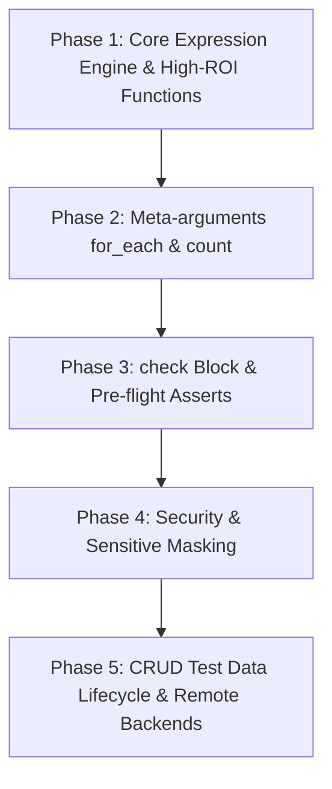

# Quantum Parity Matrix: Terraform Language vs Testform

> **Internal Architecture and Parity Document (Hidden Menu)**  
> This document provides an exhaustive, **point-by-point** breakdown of every concept, block, expression, and function in the official [Terraform Language specification](https://developer.hashicorp.com/terraform/language) compared against the architecture of **Testform (Test-as-Code)**.

---

## Table of Contents
1. [Parity Methodology](#parity-methodology)
2. [Part I: Core Language Components (1 to 14)](#part-i-core-language-components)
3. [Part II: Special Configuration Blocks](#part-ii-special-configuration-blocks)
4. [Part III: Expression Engine and Operators](#part-iii-expression-engine-and-operators)
5. [Part IV: Point-by-Point Exhaustive Function Catalog](#part-iv-point-by-point-exhaustive-function-catalog)
   - [Functions Overview](#functions-overview)
   - [Numeric Functions](#1-numeric-functions)
   - [String Functions](#2-string-functions)
   - [Collection Functions](#3-collection-functions)
   - [Encoding Functions](#4-encoding-functions)
   - [Filesystem Functions](#5-filesystem-functions)
   - [Date and Time Functions](#6-date-and-time-functions)
   - [Hash and Crypto Functions](#7-hash-and-crypto-functions)
   - [IP Network Functions](#8-ip-network-functions)
   - [Type Conversion & Control Functions](#9-type-conversion--control-functions)
   - [Provider-Defined Functions](#10-provider-defined-functions)
6. [Part V: Strategic Implementation Roadmap](#part-v-strategic-implementation-roadmap)
7. [How to Access and Navigate this Document](#how-to-access-and-navigate-this-document)

---

## Parity Methodology

Each evaluated item examines four dimensions:
- **Testform Status:** `Implemented`, `Partial`, `Not Implemented`, or `Native Alternative`.
- **Terraform Purpose:** Justification of the concept in Infrastructure as Code (IaC).
- **Comparison / Gap:** The exact capability Testform needs to achieve parity.
- **Applies to Testform?:** Feasibility and technical ROI evaluation in Automated Testing (E2E/API).

---

## Part I: Core Language Components

### 1. Configure Provider
- **Testform Status:** `Implemented` (via `main.yml` with Playwright, Cypress, Appium, Artillery, K6 plugins).
- **Terraform Purpose:** Connect Terraform to external APIs (AWS, Azure, GCP, GitHub) via decoupled gRPC binaries.
- **Comparison / Gap:** Terraform supports multiple instances of the same provider using aliases (`provider "aws" { alias = "west" }`). In Testform, provider configuration is global or per-step; lacks alias support (`provider: playwright.firefox` vs `provider: playwright.chrome` within the same feature).
- **Applies to Testform?:** **Yes (High priority)**. Enables simultaneous multi-browser or multi-tenant tests in a single scenario.

### 2. Resources (`resource`)
- **Testform Status:** `Implemented` (Gherkin Scenarios and Steps are declarative testing resources with address ID `feature.tag`).
- **Terraform Purpose:** Represents infrastructure components with CRUD lifecycle managed by state.
- **Comparison / Gap:** Terraform tracks state of individual attributes post-creation (`resource.server.private_ip`). In Testform, the resource is a test scenario whose state is `passed`, `failed`, `skipped` along with its generated `outputs`.
- **Applies to Testform?:** **Adapted and Implemented**. In Testform, assertions and execution steps form the managed resources.

### 3. Data Sources (`data`)
- **Testform Status:** `Implemented` (via `data:` in `data.yml` or inline, JSON/YAML fixtures, `${data.<source>.<key>}` resolution).
- **Terraform Purpose:** Read information from external resources without managing or destroying them (e.g., query existing AMI ID).
- **Comparison / Gap:** Terraform supports dynamic Data Sources provided by plugins (`data "aws_ami" "ubuntu" { filter {...} }`). In Testform, current Data Sources are static (local JSON/YAML/CSV files). Dynamic Data Sources via Provider (e.g. `data: api_query` executing a preliminary GET request) are not yet supported.
- **Applies to Testform?:** **Yes (High priority)**. Dynamic Data Sources via API before the plan.

### 4. Variables (`variable`)
- **Testform Status:** `Implemented` (via `vars.yml`, environment variables `TF_VAR_*`, CLI `--var` and flags).
- **Terraform Purpose:** Parameterize modules and configurations without hardcoding credentials or URLs.
- **Comparison / Gap:** Terraform supports `validation { condition = ... error_message = ... }` and strict typing (`type = list(string)`). In Testform, variables are dynamically typed based on YAML. Validation blocks in `vars.yml` are not yet supported.
- **Applies to Testform?:** **Yes (Medium priority)**. Declarative variable validation prior to test execution.

### 5. Locals (`locals`)
- **Testform Status:** `Implemented` (via `local.yml` and `locals:` blocks, evaluated with interpolation `${local.<name>}`).
- **Terraform Purpose:** Avoid repetition of complex expressions by giving them a reusable local name.
- **Comparison / Gap:** Terraform allows cascading references (`local.b = "${local.a}/path"`). Testform already resolves these recursively, achieving near 100% parity.
- **Applies to Testform?:** **Fully Implemented**.

### 6. Outputs (`output`)
- **Testform Status:** `Implemented` (via `outputs:`, `outputs.yml`, CLI `testform output [name] [-raw] [-json]`, persisted in `testform.state`).
- **Terraform Purpose:** Export values from child modules or share data between workspaces.
- **Comparison / Gap:** Terraform supports `precondition` in outputs and `sensitive = true` marking. Testform lacks `sensitive: true` masking in the console.
- **Applies to Testform?:** **Partially Implemented**. Add masking support for sensitive outputs.

### 7. Meta-arguments
- **`depends_on`:**
  - **Status:** `Implemented` (via `@depends_on("feature.tag")`, topological DAG sorting, circular cycle detection, visualized in `testform graph`).
  - **Gap:** Full parity achieved.
- **`lifecycle`:**
  - **Status:** `Implemented` (`prevent_destroy`, `ignore_changes` on steps and scenarios).
  - **Gap:** Missing `create_before_destroy` and `replace_triggered_by`.
- **`count`:**
  - **Status:** `Not Implemented`.
  - **Purpose:** Multiply resource instances N times.
  - **Gap:** Generate N repetitions of a test scenario based on an integer.
  - **Applies?:** **Yes (High priority)**. Stress testing and flaky test repetition.
- **`for_each`:**
  - **Status:** `Not Implemented`.
  - **Purpose:** Create resources iterating over a map or set.
  - **Gap:** Mass declarative data-driven testing over lists/maps in `vars.yml`.
  - **Applies?:** **Yes (Highest priority)**. Orchestration-level equivalent to Scenario Outlines.
- **`provider`:**
  - **Status:** `Not Implemented`.
  - **Purpose:** Assign specific provider aliases to a resource.
  - **Gap:** Browser/device selector in scenario tags (`@provider("playwright.webkit")`).
  - **Applies?:** **Yes**.

### 8. Sensitive Data
- **Testform Status:** `Partial` (Safe environment variable support, but no log redaction).
- **Terraform Purpose:** Hide passwords, tokens, and keys in CLI output, plan diffs, and execution logs.
- **Comparison / Gap:** In Testform, if a step uses `${var.password}`, the value may be displayed in logs or HTML reports. Masking with `***` is missing.
- **Applies to Testform?:** **Yes (High priority)**. Essential for compliance and security in CI/CD.

### 9. Backends
- **Testform Status:** `Partial` (Local state with `testform.state` and `testform.state.lock`).
- **Terraform Purpose:** Store state files in shared remote storage (S3, GCS, HTTP, Terraform Cloud) with distributed locking.
- **Comparison / Gap:** Testform lacks native remote backends (`backend "s3"` in `main.yml`) for sharing state across parallel CI/CD runners.
- **Applies to Testform?:** **Yes (Medium priority)**. Vital for distributed CI/CD pipelines.

### 10. Search and Import
- **Testform Status:** `Not Implemented`.
- **Terraform Purpose:** Bring existing external infrastructure under state control (`terraform import ...`).
- **Comparison / Gap:** In Testform, import previous test execution results from external runners (e.g. import JUnit/Cucumber JSON report into Testform state to skip previously passed tests).
- **Applies to Testform?:** **Yes**. `testform import <feature.tag> <junit.xml>`.

### 11. State & State Management
- **Testform Status:** `Implemented` (JSON state storage, `.lock` locking, drift detection in `refresh`, inspection commands).
- **Terraform Purpose:** Map declared resources against physical reality.
- **Comparison / Gap:** Missing CLI commands: `testform state list`, `testform state rm <address>`, `testform state show <address>`.
- **Applies to Testform?:** **Yes**. Allows QA engineers to inspect and modify test state directly.

### 12. Stacks (Terraform Stacks)
- **Testform Status:** `Not Implemented`.
- **Terraform Purpose:** Multi-module, multi-environment orchestration with cross-stack dependency graphs.
- **Comparison / Gap:** In Testform, this corresponds to a "Suite of Suites" or "Test Pipeline Stack" orchestrating Smoke $\rightarrow$ Regression $\rightarrow$ Performance pipelines.
- **Applies to Testform?:** **Yes (Long-term enterprise vision)**.

### 13. Validate
- **Testform Status:** `Implemented` (`testform validate` checks YAML syntax, module tags, circular dependencies, and feature paths).
- **Terraform Purpose:** Verify configuration consistency without touching infrastructure or state.
- **Comparison / Gap:** Terraform validates expression types and provider argument schemas. Testform should validate that variables referenced in `${var.name}` exist in `vars.yml`.
- **Applies to Testform?:** **Yes**.

### 14. Extend CRUD Operations
- **Testform Status:** `Partial` (Test lifecycle hooks `Before` / `After`, but no formal data seed CRUD lifecycle).
- **Terraform Purpose:** Providers implement Create, Read, Update, Delete for each resource.
- **Comparison / Gap:** In Testform, allow tests to declare auxiliary test data entities with managed lifecycles (seed a test user in DB before test, update roles, destroy on cleanup).
- **Applies to Testform?:** **Yes (High value in Test-as-Code)**. Automatic test data seeding and cleanup.

---

## Part II: Special Configuration Blocks

| HCL Block | Testform Status | Applies to Testform? | Equivalent / Proposal in Testform |
|---|---|---|---|
| `check "health_check"` | `Not Implemented` | **Yes (Very High)** | Continuous non-blocking assertions (e.g. verify `/health` responds 200 before running the E2E suite). |
| `ephemeral "resource"` | `Not Implemented` | **Yes (Medium)** | Volatile resources (like temporary session tokens) that should not be persisted in state. |
| `import { to = ... id = ... }` | `Not Implemented` | **Low** | Declarative test result imports in YAML. |
| `removed { from = ... }` | `Not Implemented` | **Medium** | Mark deprecated tests without failing plans or leaving orphan state. |
| `query "data"` | `Not Implemented` | **Low** | Reactive configuration queries. |

---

## Part III: Expression Engine and Operators

### 1. Types and Literals
- **Terraform:** `string`, `number`, `bool`, `list`, `map`, `object`, `tuple`, `null`.
- **Testform:** Inherited YAML typing + interpolated strings.
- **Gap:** Explicit type coercion in expressions (e.g., converting `"123"` to a number).

### 2. Ternary Operator (`condition ? true_val : false_val`)
- **Status:** `Not Implemented`.
- **Purpose:** Dynamic values based on environment (`var.env == "prod" ? "https://app.com" : "https://staging.app.com"`).
- **Applies?:** **Yes (Highest priority)**. Critical for multi-environment test suites.

### 3. Template Directives (`%{if ...}`, `%{for ...}`)
- **Status:** `Not Implemented`.
- **Purpose:** Complex string or JSON generation with embedded loops and branches.
- **Applies?:** **Medium**. Test fixtures generally cover this.

### 4. For Expressions and Splat (`[*]`)
- **Status:** `Not Implemented`.
- **Purpose:** Extract attributes from lists of objects (`[for u in var.users : u.id]` or `var.users[*].id`).
- **Applies?:** **Yes**. Useful when API responses return object lists and UI assertions must verify all IDs.

---

## Part IV: Point-by-Point Exhaustive Function Catalog

### Functions Overview
In Terraform, functions are deterministic utilities callable inside `${...}` expressions. In Testform, interpolations currently resolve simple identifiers (`${var.x}`, `${local.x}`, `${data.x.y}`, `${module.x.y}`). Implementing a full function engine will transform Testform expressions into a complete automation engine.

---

### 1. Numeric Functions

#### `abs(number)`
- **Testform Status:** `Not Implemented`.
- **Terraform Purpose:** Returns the absolute value of a number.
- **Applies to Testform?:** **Yes (Adapted)**. Deltas and tolerances in assertions (e.g. verifying response time is within $\pm 200$ ms: `abs(actual_ms - expected_ms) < 200`).

#### `ceil(number)`
- **Testform Status:** `Not Implemented`.
- **Terraform Purpose:** Rounds up to the nearest integer.
- **Applies to Testform?:** **Yes**. Pagination page calculation (`ceil(total_records / page_size)`).

#### `floor(number)`
- **Testform Status:** `Not Implemented`.
- **Terraform Purpose:** Rounds down to the nearest integer.
- **Applies to Testform?:** **Yes**. Grid indices and random range offsets.

#### `log(number, base)`
- **Testform Status:** `Not Implemented`.
- **Terraform Purpose:** Computes logarithms.
- **Applies to Testform?:** **No (Low value in functional testing)**.

#### `max(numbers...)` / `min(numbers...)`
- **Testform Status:** `Not Implemented`.
- **Terraform Purpose:** Returns maximum / minimum of given numbers.
- **Applies to Testform?:** **Yes**. Dynamic timeout calculations and threshold assertions.

#### `parseint(string, base)`
- **Testform Status:** `Not Implemented`.
- **Terraform Purpose:** Parses a string into an integer.
- **Applies to Testform?:** **Yes**. Parsing extracted UI strings (`"Total: 45 items"` $\rightarrow$ `45`).

#### `pow(number, exponent)` / `signum(number)`
- **Testform Status:** `Not Implemented`.
- **Terraform Purpose:** Powers and sign checking.
- **Applies to Testform?:** **Low priority**.

---

### 2. String Functions

#### `chomp(string)`
- **Testform Status:** `Not Implemented`.
- **Applies to Testform?:** **Yes**. Cleaning trailing newlines from CLI stdout or fixture files.

#### `endswith(string, suffix)` / `startswith(string, prefix)`
- **Testform Status:** `Not Implemented`.
- **Applies to Testform?:** **Yes**. Assertions on URL suffixes or token prefixes (`Bearer `).

#### `format(format, values...)` / `formatlist(format, list)`
- **Testform Status:** `Not Implemented`.
- **Applies to Testform?:** **Yes (High priority)**. Dynamic selector construction (`format("user_%03d@test.com", var.index)`).

#### `join(separator, list)` / `split(separator, string)`
- **Testform Status:** `Not Implemented`.
- **Applies to Testform?:** **Yes (High priority)**. Joining query parameters and parsing HTTP headers.

#### `lower(string)` / `upper(string)`
- **Testform Status:** `Not Implemented`.
- **Applies to Testform?:** **Yes (High priority)**. Case-insensitive assertions and data normalization.

#### `regex(pattern, string)` / `regexall(pattern, string)`
- **Testform Status:** `Not Implemented`.
- **Applies to Testform?:** **Yes (Highest priority)**. Extracting OTP verification codes, tokens, or IDs from strings.

#### `replace(string, substr, replacement)`
- **Testform Status:** `Not Implemented`.
- **Applies to Testform?:** **Yes (High priority)**. String sanitization for dynamic CSS selectors.

#### `trim(string, chars)` / `trimspace(string)`
- **Testform Status:** `Not Implemented`.
- **Applies to Testform?:** **Yes (High priority)**. Trimming whitespace captured from browser elements.

---

### 3. Collection Functions

#### `alltrue(list)` / `anytrue(list)`
- **Testform Status:** `Not Implemented`.
- **Applies to Testform?:** **Yes (High priority)**. Compound boolean assertions on checkbox lists.

#### `coalesce(vals...)`
- **Testform Status:** `Not Implemented`.
- **Applies to Testform?:** **Yes (High priority)**. Variable fallbacks (`coalesce(var.custom_url, var.default_url, "http://localhost")`).

#### `contains(list, value)`
- **Testform Status:** `Not Implemented`.
- **Applies to Testform?:** **Yes (Highest priority)**. Dropdown and list membership assertions.

#### `distinct(list)` / `flatten(list)`
- **Testform Status:** `Not Implemented`.
- **Applies to Testform?:** **Yes**. Deduplicating test tags and flattening nested API response arrays.

#### `length(collection_or_string)`
- **Testform Status:** `Not Implemented`.
- **Applies to Testform?:** **Yes (Highest priority)**. Row counts and list length assertions (`length(rows) == 10`).

#### `lookup(map, key, default)`
- **Testform Status:** `Not Implemented`.
- **Applies to Testform?:** **Yes (Highest priority)**. Safe environment config lookups without exceptions.

#### `merge(maps...)`
- **Testform Status:** `Not Implemented`.
- **Applies to Testform?:** **Yes (High priority)**. Merging global HTTP headers with scenario headers.

#### `sort(list)` / `sum(list)`
- **Testform Status:** `Not Implemented`.
- **Applies to Testform?:** **Yes**. Validating sorted table columns and shopping cart totals (`sum(item_prices) == cart_total`).

---

### 4. Encoding Functions

#### `base64encode(string)` / `base64decode(string)`
- **Testform Status:** `Not Implemented`.
- **Applies to Testform?:** **Yes (High priority)**. Constructing `Authorization: Basic ...` headers.

#### `jsonencode(value)` / `jsondecode(string)`
- **Testform Status:** `Not Implemented`.
- **Applies to Testform?:** **Yes (Highest priority)**. Serializing and parsing REST JSON payloads in expressions.

#### `csvdecode(string)`
- **Testform Status:** `Not Implemented`.
- **Applies to Testform?:** **Yes (Highest priority)**. Importing tabular datasets for Data-Driven Testing.

#### `urlencode(string)`
- **Testform Status:** `Not Implemented`.
- **Applies to Testform?:** **Yes (High priority)**. Escaping query parameters.

---

### 5. Filesystem Functions

#### `file(path)` / `fileexists(path)` / `filebase64(path)`
- **Testform Status:** `Not Implemented`.
- **Applies to Testform?:** **Yes (Highest priority)**. Loading test payloads, checking downloaded files, and file uploads.

#### `templatefile(path, vars)`
- **Testform Status:** `Not Implemented`.
- **Applies to Testform?:** **Yes (High priority)**. Parameterized payload and email templates.

---

### 6. Date and Time Functions

#### `timestamp()`
- **Testform Status:** `Not Implemented`.
- **Applies to Testform?:** **Yes (Highest priority)**. Generating unique usernames and emails per run (`"user_" + timestamp() + "@test.com"`).

#### `formatdate(spec, timestamp)`
- **Testform Status:** `Not Implemented`.
- **Applies to Testform?:** **Yes (High priority)**. Regional date formats in forms (`DD/MM/YYYY`, `YYYY-MM-DD`).

#### `timeadd(timestamp, duration)` / `timecmp(a, b)`
- **Testform Status:** `Not Implemented`.
- **Applies to Testform?:** **Yes**. Expiration testing and timestamp comparisons.

---

### 7. Hash and Crypto Functions

#### `uuid()`
- **Testform Status:** `Not Implemented`.
- **Applies to Testform?:** **Yes (Highest priority)**. Unique test records and correlation headers (`X-Request-ID: uuid()`).

#### `sha256(string)` / `md5(string)`
- **Testform Status:** `Not Implemented`.
- **Applies to Testform?:** **Yes**. Integrity checks on downloaded test artifacts.

---

### 8. IP Network Functions

#### `cidrhost(...)` / `cidrsubnet(...)`
- **Testform Status:** `Not Implemented`.
- **Applies to Testform?:** **No (Low value)**. Testform focuses on application testing, not VPC network provisioning.

---

### 9. Type Conversion & Control Functions

#### `can(expression)` / `try(expressions...)`
- **Testform Status:** `Not Implemented`.
- **Applies to Testform?:** **Yes (Highest priority)**. Resilient fallbacks for optional fields in API responses.

#### `sensitive(value)` / `nonsensitive(value)`
- **Testform Status:** `Not Implemented`.
- **Applies to Testform?:** **Yes**. Hiding credentials in execution output.

#### `tostring()`, `tonumber()`, `tobool()`, `tolist()`
- **Testform Status:** `Not Implemented`.
- **Applies to Testform?:** **Yes (High priority)**. Explicit type conversions from DOM strings.

---

### 10. Provider-Defined Functions

- **In Terraform:** Supported in TF 1.8+ via `provider::name::function()`.
- **In Testform:**
  - **Status:** `Not Implemented`.
  - **Vision:** Testform plugins can export helper functions (e.g., `provider::playwright::selector_escape(sel)` or `provider::faker::credit_card()`).

---

## Part V: Strategic Implementation Roadmap

### Detailed Roadmap Phases
1. **Phase 1: Expression Engine & High-ROI Functions**
   - `${fn(...)}` syntax and ternary `${cond ? a : b}`.
   - Core testing bundle: `uuid()`, `timestamp()`, `lower()`, `upper()`, `replace()`, `trim()`, `jsonencode()`, `jsondecode()`, `length()`, `lookup()`, `try()`, `file()`.
2. **Phase 2: Meta-arguments `for_each` & `count`**
   - Declarative data-driven testing directly over lists/maps in `vars.yml` or CSV/JSON fixtures.
3. **Phase 3: `check` Block (Pre-flight Health Checks)**
   - Pre-condition checks validating system/API availability before executing test plans.
4. **Phase 4: Security & Secret Redaction (`sensitive`)**
   - Automatic secret masking across CLI output, logs, traces, and HTML reports.
5. **Phase 5: CRUD Test Data Lifecycle & Remote Backends**
   - Entity seeding and teardown (`before_apply`, `on_destroy`).
   - S3 / HTTP remote state backends for distributed CI/CD runners.

---

## How to Access and Navigate this Document

This document is configured with `display: 'hidden'` in the Nextra documentation setup, keeping it **hidden from the main sidebar** to prevent cluttering the end-user guide.

### Direct Access Routes:
- **Spanish (Local Dev Server):**  
  `http://localhost:3000/docs/terraform-parity` or `http://localhost:3000/es/docs/terraform-parity`
- **English (Local Dev Server):**  
  `http://localhost:3000/en/docs/terraform-parity`
- **Markdown Source Files in Repository:**  
  `docs/content/es/docs/terraform-parity.mdx` & `docs/content/en/docs/terraform-parity.mdx`
- **Direct Internal Copy in Docs Root:**  
  `docs/README.md`
