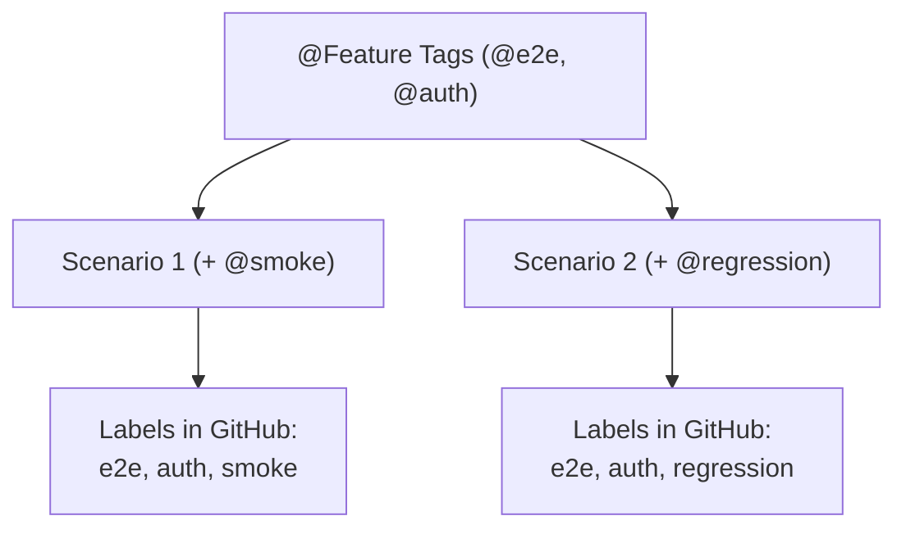

# Tagging Strategy & Labels

Tags in Gherkin start with the `@` symbol. In Testform, tags are not just markers for test runners—they define **resource types**, **remote labels**, and **unique identity bindings**.

---

## 1. Scope Tags (Resource Definition)

Testform uses top-level feature tags to determine which resource type to provision:

| Tag | Target Resource | File Suffix Equivalent |
| :--- | :--- | :--- |
| `@testcase` | Individual Test Case Issue | `*.case.feature` |
| `@testrun` | Test Execution Run with Checklists | `*.run.feature` |
| `@testplan` | Umbrella Release Plan / Epic | `*.plan.feature` |

```gherkin
@testcase
Feature: Search Functionality
  # Testform treats every Scenario below as a github_testcase resource
```

---

## 2. Unique Identity Tags (`@tc-id`)

One of Testform's most powerful features is **Identity Persistence** (equivalent to a resource's logical name in Terraform).

In standard Git repositories, if a Quality Engineer updates a scenario title:
- *Without identity tracking*: The system assumes the old test was deleted and creates a brand new one, duplicating tickets and losing comment history.
- *With Testform Identity Tags*: Testform recognizes the permanent identity and updates the existing remote issue in-place without duplicating anything.

```gherkin
  # The @tc-1 tag anchors this scenario to its remote ID permanently
  @smoke @tc-1
  Scenario: Search with valid keywords returns results
    Given the user navigates to "/search"
    When the user searches for "laptop"
    Then search results are displayed
```

The standard format is `@tc-[number]` or a mnemonic name like `@tc-login` (defined by the `identity: "tc-*"` pattern in `testform.yml`). Testform uses this to form the resource key in state:
`search.case.feature::@tc-1`.

> [!IMPORTANT]
> **Mandatory Policy `identity-required`:** Every scenario must declare its identity tag (e.g. `@tc-1`). Testform validates this policy before every operation (`plan`, `apply`, `validate`). This identity tag is required because downstream resources like `testrun` bind executions via `Rule: file.case.feature -> Scenario: @tc-id`.


---

## 3. Categorization & GitHub Labels

Any tag not reserved for scopes or identity is automatically translated into a remote label:

```gherkin
@checkout @payment @high-priority
Feature: Payment Methods

  @visa @credit-card
  Scenario: Pay with valid Visa card
```

### Inherited Labels:
- The Scenario inherits the Feature tags: `checkout`, `payment`, `high-priority`.
- The Scenario has its own tags: `visa`, `credit-card`.
- Remote Issue Created in GitHub:
  - **Labels**: `checkout`, `payment`, `high-priority`, `visa`, `credit-card`.

---

## 4. Tag Inheritance Rules

Tags declared at the `Feature:` level cascade down to all Scenarios in that file:


