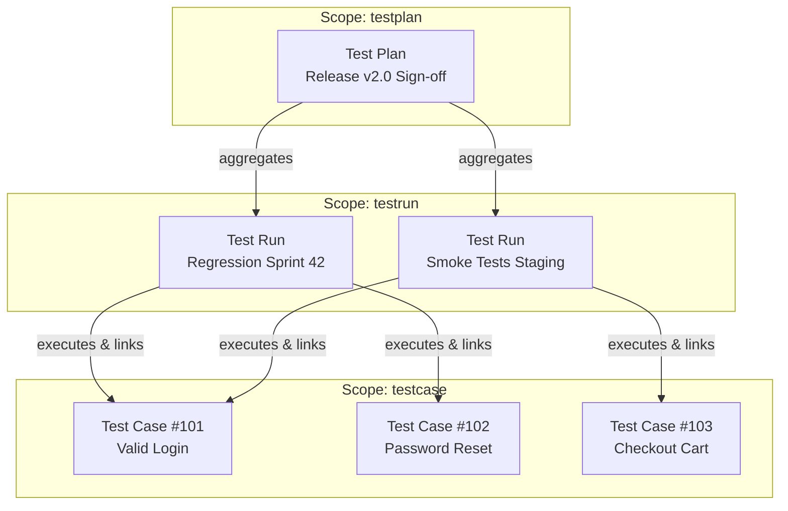

# Resource Hierarchy

Testform organizes test infrastructure into a three-tiered hierarchical pyramid. Each tier corresponds to a specific **Scope** within the CLI and maps to a distinct resource managed by the active Provider.



---

## The Three Tiers

### 1. `testcase` (The Atomic Specification)
- **Granularity**: 1 Gherkin `Scenario` = 1 Remote Issue.
- **File convention**: `*.case.feature` or `@testcase` at the Feature level.
- **Purpose**: Defines acceptance criteria, preconditions, steps (`Given`/`When`/`Then`), tags (labels), and custom field values.
- **Identity in State**: `[filename.case.feature]::@tc-1` (or according to configured pattern in `testform.yml`: `tc-*`, `tr-*`, `tp-*`, validated by `identity-required`).

### 2. `testrun` (The Execution Unit)
- **Granularity**: 1 Gherkin `Feature` file = 1 Remote Issue (with checklists and comments).
- **File convention**: `*.run.feature` or `@testrun` at the Feature level.
- **Purpose**: Represents an execution cycle. It imports testcases via `Rule: filename.case.feature` and records pass/fail/blocked execution statuses (`* link status = passed`).
- **Identity in State**: `[filename.run.feature]`.

### 3. `testplan` (The Umbrella Campaign)
- **Granularity**: 1 Gherkin `Feature` file = 1 Remote Umbrella Milestone or Tracking Issue.
- **File convention**: `*.plan.feature` or `@testplan` at the Feature level.
- **Purpose**: High-level governance, grouping multiple Testruns across platforms, environments, or teams into a single release sign-off board.
- **Identity in State**: `[filename.plan.feature]`.

---

## Controlling Hierarchy via `-scope`

You can execute commands targeting the entire infrastructure or scope your work to a specific tier:

```bash
# Manage only test cases
testform plan -scope=testcase
testform apply -scope=testcase

# Manage only execution runs
testform plan -scope=testrun
testform apply -scope=testrun

# Manage release plans
testform plan -scope=testplan
testform apply -scope=testplan
```
