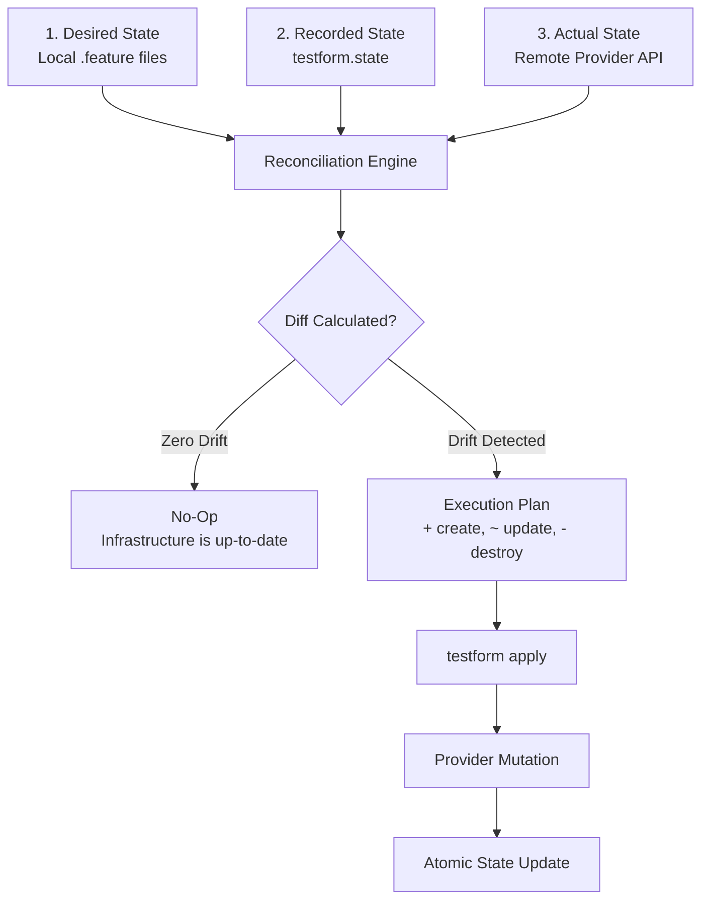

# The Reconciliation Loop

At the core of Testform lies the **Declarative Reconciliation Engine**. Rather than executing arbitrary imperative scripts that create issues or modify status flags blindly, Testform continuously aligns your remote infrastructure with your local declarative definitions.

---

## The Three-Way State Engine

Testform reconciles three distinct representations of truth:



### 1. Desired State (Local Code)
Your `.feature` files under version control. This represents what your testing environment *should* look like.

### 2. Actual State (Remote Reality)
The live issues, milestones, and project items currently present in GitHub, Jira, or GitLab. If a team member modifies an issue title or removes a label manually in the web UI, this creates an **out-of-band drift**.

### 3. Recorded State (`testform.state`)
The snapshot taken by Testform after the last successful `apply`. It links local scenarios (identified by their unique tag or filename) to their exact remote IDs and URLs.

---

## Deterministic Hashing (`localHash`)

To minimize remote API requests and guarantee idempotency, Testform computes a cryptographic SHA-256 fingerprint of each local resource:

```text
localHash = SHA-256(Scenario Title + Steps + Tags + DSL Variables)
```

### How Testform Evaluates Drift:
- **No changes**: If `localHash == state.localHash`, Testform skips the resource entirely.
- **Local update**: If `localHash != state.localHash`, Testform flags the resource with `~ update in-place` and calculates the minimal property diff.
- **New resource**: If the scenario has no corresponding identity in `testform.state`, Testform flags it with `+ create`.
- **Deleted resource**: If a resource exists in `testform.state` but no longer appears in any local `.feature` file, Testform flags it with `- destroy`.

---

## Idempotency in Practice

An operation is **idempotent** if running it multiple times produces the exact same result as running it once, without unintended side effects.

If you run:
```bash
testform apply
```
And immediately run it again without modifying any `.feature` files:
```bash
$ testform apply

No changes. Your testing infrastructure matches the configuration.

Apply complete! Resources: 0 added, 0 changed, 0 destroyed.
```
Zero API calls are made to GitHub, preserving your API rate limits and preventing duplicate tickets.
