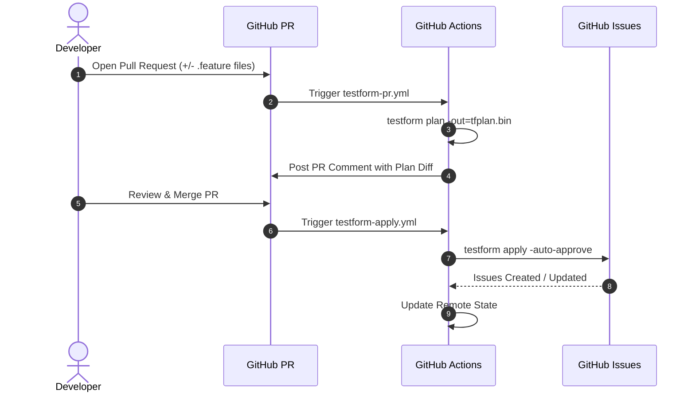

# CI/CD with GitHub Actions

Automating Testform in CI/CD ensures that your team's test management issues stay 100% in sync with code branches, pull requests, and releases.

---

## The Recommended Pull Request Workflow

1. **Pull Request Opened / Updated**: Run `testform plan` and post the execution diff as an automated comment on the PR.
2. **Pull Request Merged into `main`**: Run `testform apply -auto-approve` to synchronize changes to GitHub Issues.



---

## Production GitHub Actions Workflow

Create `.github/workflows/testform.yml`:

```yaml
name: Test-as-Code Sync

on:
  pull_request:
    paths:
      - 'tests/**/*.feature'
      - 'testform.yml'
  push:
    branches:
      - main
    paths:
      - 'tests/**/*.feature'
      - 'testform.yml'

jobs:
  testform:
    runs-on: ubuntu-latest
    permissions:
      contents: read
      issues: write
      pull-requests: write

    steps:
      - name: Checkout Code
        uses: actions/checkout@v4

      - name: Setup Node.js
        uses: actions/setup-node@v4
        with:
          node-version: 20

      - name: Install Testform
        run: npm install -g @fromeroc9/testform

      - name: Initialize Testform
        run: testform init -backend-config="bucket=${{ secrets.TF_STATE_BUCKET }}"
        env:
          AWS_ACCESS_KEY_ID: ${{ secrets.AWS_ACCESS_KEY_ID }}
          AWS_SECRET_ACCESS_KEY: ${{ secrets.AWS_SECRET_ACCESS_KEY }}

      # On Pull Request: Plan and comment
      - name: Testform Plan
        if: github.event_name == 'pull_request'
        run: testform plan -no-color
        env:
          GITHUB_TOKEN: ${{ secrets.GITHUB_TOKEN }}

      # On Merge: Apply changes
      - name: Testform Apply
        if: github.event_name == 'push' && github.ref == 'refs/heads/main'
        run: testform apply -auto-approve
        env:
          GITHUB_TOKEN: ${{ secrets.GITHUB_TOKEN }}
```
