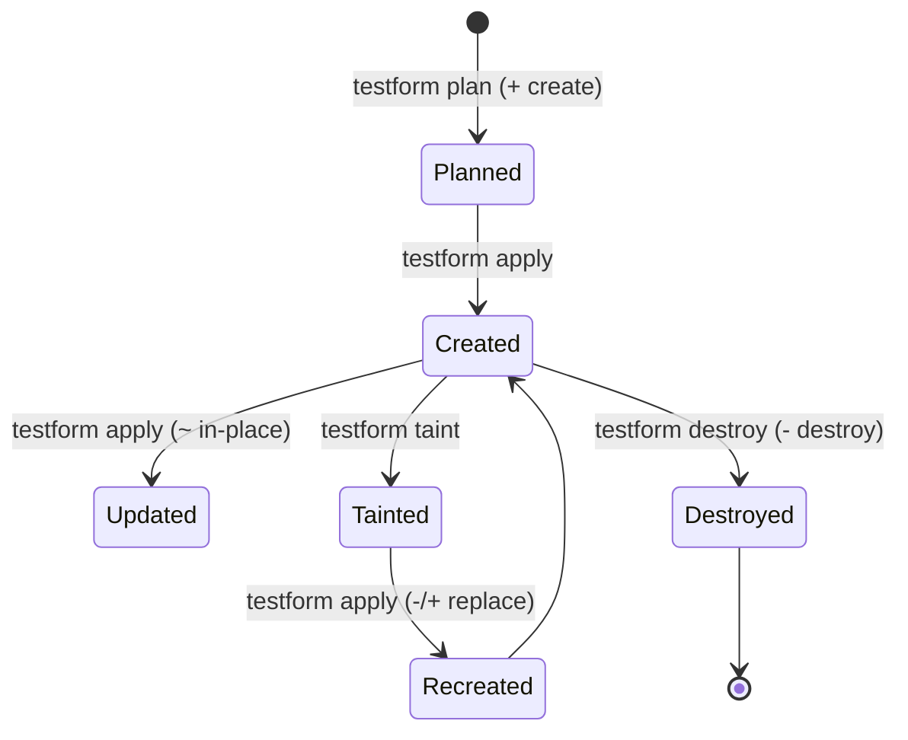

# Resource Lifecycle

Every managed resource in Testform undergoes a predictable, deterministic lifecycle governed by state comparison.

---

## The Four Lifecycle States



---

## 1. Creation (`+ create`)
- **Trigger**: A new Scenario or Feature exists locally without an entry in `testform.state`.
- **Action**: Testform creates the remote Issue, captures the returned issue number, URL, and node ID, and writes them atomically to `testform.state`.

---

## 2. In-Place Update (`~ update in-place`)
- **Trigger**: A scenario has been edited (e.g., steps changed, tag added, milestone updated) and its SHA-256 `localHash` differs from the state file.
- **Action**: Testform sends an API `PATCH` / `UPDATE` request modifying only the changed fields, leaving comments and issue IDs intact.

---

## 3. Destruction (`- destroy`)
- **Trigger**: A scenario was deleted locally or `testform destroy` was executed.
- **Action**: Testform transitions the remote issue to `closed` (or deletes it if configured) and purges the record from `testform.state`.

---

## 4. Replacement / Taint (`-/+ replace`)
- **Trigger**: An issue has been manually corrupted, or marked with `testform taint <identity>`.
- **Action**: During the next `apply`, Testform destroys (closes) the existing remote issue, removes the old state binding, and creates a brand-new issue with a fresh identity binding.

```bash
# Mark a resource as tainted
testform taint "login.case.feature::@tc-1"

# View the planned replacement
testform plan

# Execute the recreation
testform apply
```
