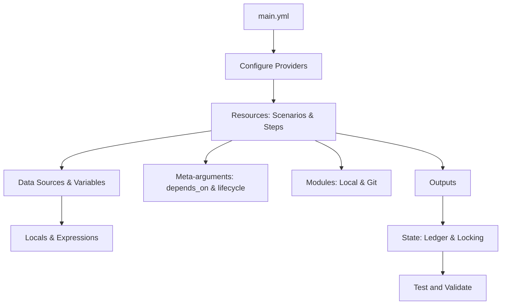

# Configuration Language en Testform

El **Lenguaje de Configuración de Testform** es la interfaz declarativa para especificar casos de prueba, dependencias, fuentes de datos y orquestación de calidad siguiendo el paradigma **Test-as-Code (TaC)**.

Al igual que [Terraform Language](https://developer.hashicorp.com/terraform/language) permite modelar infraestructura mediante bloques declarativos, Testform permite modelar la **intención de prueba de software** combinando la legibilidad universal de **Gherkin** con la potencia de configuración de **YAML**.

---

## Principios del Lenguaje

1. **Declarativo sobre Imperativo:** Describes el estado deseado de validación del software (`Given`, `When`, `Then`), no scripts frágiles ni código procedural encolado.
2. **Versionado en Git:** Todo el ecosistema de pruebas (escenarios, variables, fixtures, aserciones y salidas) vive en el repositorio como código fuente auditable.
3. **Gestión de Estado Determinista:** Un archivo de estado (`testform.state`) registra el resultado y los atributos de cada recurso de prueba para planificar ejecuciones incrementales.
4. **Composición Modular:** Reutiliza suites completas o pasos parametrizados mediante el meta-argumento `@module` con fuentes locales o repositorios Git remotos.

---

## Componentes del Lenguaje

La navegación lateral organiza cada bloque y capacidad activa de Testform:

### 1. [Configure Providers](./providers)
Configuración de plataformas de gestión (`github`, `gitlab`, `jira`, `local`) en `main.yml`.

### 2. [Resources](./resources)
Los escenarios y pasos de Gherkin actúan como recursos declarativos con direcciones canónicas (`featurepath.tag`) y ciclo de vida gestionado.

### 3. [Data Sources](./data-sources)
Fuentes de datos de solo lectura (`data.yml`, fixtures JSON/YAML) accesibles en plantillas vía `${data.<source>.<key>}`.

### 4. [Variables](./variables)
Parámetros de entrada configurables vía `vars.yml`, variables de entorno `TF_VAR_*` y flags de línea de comandos.

### 5. [Locals](./locals)
Valores locales calculados y reutilizables declarados en `local.yml` para simplificar expresiones complejas.

### 6. [Outputs](./outputs)
Valores exportados por las pruebas persistidos en el ledger de estado y consultables con `testform output` o `${module.<name>.<output>}`.

### 7. [Modules](./modules)
Empaquetado y reutilización de suites de prueba mediante `@module`, con soporte para repositorios Git y paso de parámetros `vars={...}`.

### 8. [Meta-arguments](./meta-arguments)
Directivas avanzadas que alteran la orquestación:
- **[depends_on](./meta-arguments/depends-on):** Grafo acíclico dirigido (DAG) de dependencias entre pruebas.
- **[lifecycle](./meta-arguments/lifecycle):** Protección contra destrucción (`prevent_destroy`) y supresión de falsos positivos (`ignore_changes`).

### 9. [Search and Import](./search-and-import)
Búsqueda y filtrado de recursos en el estado con `testform query` e incorporación de incidencias remotas con `testform import`.

### 10. [State](./state)
El ledger de conciliación (`testform.state`), el bloqueo concurrente (`testform.state.lock`) y la detección de deriva (drift).

### 11. [Test and Validate](./validate)
Verificación estática con `testform validate` e inspección previa con `testform plan` antes de ejecutar.
