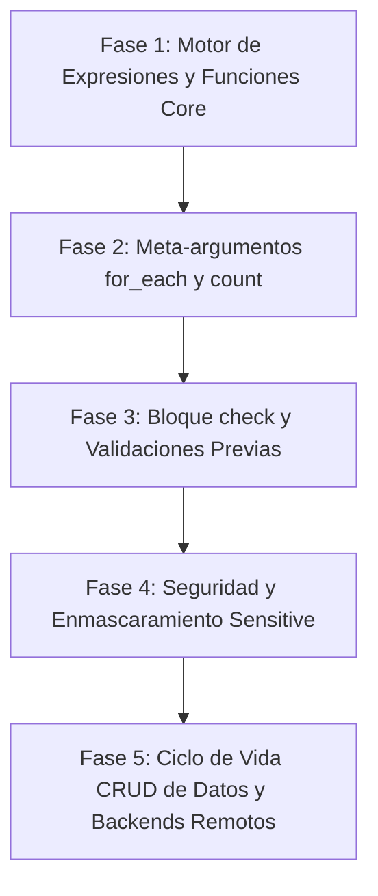

# Matriz Cuántica de Paridad: Terraform Language vs Testform

> **Documento Interno de Arquitectura y Paridad (Menú Oculto)**  
> Este documento desglosa **punto por punto** y de manera exhaustiva cada concepto, bloque, expresión y función de la especificación oficial de [Terraform Language](https://developer.hashicorp.com/terraform/language) frente a la arquitectura de **Testform (Test-as-Code)**.

---

## Índice General
1. [Metodología de Paridad](#metodología-de-paridad)
2. [Parte I: Componentes Principales del Lenguaje (1 al 14)](#parte-i-componentes-principales-del-lenguaje)
3. [Parte II: Bloques Especiales de Configuración](#parte-ii-bloques-especiales-de-configuración)
4. [Parte III: Motor de Expresiones y Operadores](#parte-iii-motor-de-expresiones-y-operadores)
5. [Parte IV: Catálogo Exhaustivo de Funciones Punto por Punto](#parte-iv-catálogo-exhaustivo-de-funciones-punto-por-punto)
   - [Overview de Funciones](#overview-de-funciones)
   - [Numeric Functions](#1-numeric-functions)
   - [String Functions](#2-string-functions)
   - [Collection Functions](#3-collection-functions)
   - [Encoding Functions](#4-encoding-functions)
   - [Filesystem Functions](#5-filesystem-functions)
   - [Date and Time Functions](#6-date-and-time-functions)
   - [Hash and Crypto Functions](#7-hash-and-crypto-functions)
   - [IP Network Functions](#8-ip-network-functions)
   - [Type Conversion & Control Functions](#9-type-conversion--control-functions)
   - [Provider-Defined Functions](#10-provider-defined-functions)
6. [Parte V: Roadmap Estratégico de Implementación](#parte-v-roadmap-estratégico-de-implementación)
7. [Cómo acceder y navegar este documento](#cómo-acceder-y-navegar-este-documento)

---

## Metodología de Paridad

Cada punto analizado evalúa cuatro dimensiones:
- **Estado en Testform:** `Implementado`, `Parcial`, `No implementado` o `Alternativa Nativa`.
- **Motivo en Terraform:** Justificación del concepto en Infraestructura como Código (IaC).
- **Comparado / Faltante (Gap):** Qué capacidad exacta le falta a Testform para equipararse.
- **¿Aplica a Testform?:** Evaluación de viabilidad y ROI técnico en Pruebas Automatizadas (E2E/API).

---

## Parte I: Componentes Principales del Lenguaje

### 1. Configure Provider
- **Estado en Testform:** `Implementado` (vía `testform.yml` con plugins Playwright, Cypress, Appium, Artillery, K6).
- **Motivo en Terraform:** Conectar Terraform con APIs externas (AWS, Azure, GCP, GitHub) mediante binarios gRPC desacoplados.
- **Comparado / Faltante (Gap):** Terraform soporta múltiples instancias del mismo provider mediante alias (`provider "aws" { alias = "west" }`). En Testform, la configuración de providers es global o por step; falta soporte para alias de provider (`provider: playwright.firefox` vs `provider: playwright.chrome` dentro del mismo feature).
- **¿Aplica a Testform?:** **Sí (Alta prioridad)**. Permitiría pruebas multi-navegador o multi-tenant simultáneas en un solo escenario.

### 2. Resources (`resource`)
- **Estado en Testform:** `Implementado` (Los Scenarios de Gherkin y Steps son recursos de testing declarativos con ID de dirección `feature.tag`).
- **Motivo en Terraform:** Representa componentes de infraestructura con ciclo de vida CRUD gestionado por el state.
- **Comparado / Faltante (Gap):** Terraform maneja estado de atributos individuales post-creación (`resource.server.private_ip`). En Testform, el recurso es un escenario de prueba cuyo estado es `passed`, `failed`, `skipped` y sus `outputs` generados.
- **¿Aplica a Testform?:** **Adaptado e Implementado**. El recurso en Testform es la aserción y el paso de ejecución.

### 3. Data Sources (`data`)
- **Estado en Testform:** `Implementado` (vía `data:` en `data.yml` o inline, fixtures JSON/YAML, resolución `${data.<source>.<key>}`).
- **Motivo en Terraform:** Leer información de recursos externos sin gestionarlos ni destruirlos (ej. consultar AMI ID existente).
- **Comparado / Faltante (Gap):** Terraform soporta Data Sources dinámicos provistos por plugins (`data "aws_ami" "ubuntu" { filter {...} }`). En Testform los Data Sources actuales son estáticos (archivos JSON/YAML/CSV locales). Falta soporte para Data Sources dinámicos vía Provider (ej. `data: api_query` que ejecute un GET previo para alimentar el test).
- **¿Aplica a Testform?:** **Sí (Alta prioridad)**. Data Sources dinámicos vía API antes del plan.

### 4. Variables (`variable`)
- **Estado en Testform:** `Implementado` (vía `vars.yml`, variables de entorno `TF_VAR_*`, CLI `--var` y flags).
- **Motivo en Terraform:** Parametrizar módulos y configuraciones sin hardcodear credenciales ni URLs.
- **Comparado / Faltante (Gap):** Terraform soporta bloque `validation { condition = ... error_message = ... }` y tipos estrictos (`type = list(string)`). En Testform las variables son tipadas dinámicamente según YAML. Falta bloque `validation` nativo en `vars.yml`.
- **¿Aplica a Testform?:** **Sí (Media prioridad)**. Validación declarativa de variables antes de correr las pruebas.

### 5. Locals (`locals`)
- **Estado en Testform:** `Implementado` (vía `local.yml` y bloque `locals:`, evaluados con interpolación `${local.<name>}`).
- **Motivo en Terraform:** Evitar repetición de expresiones complejas asignándoles un nombre reutilizable local.
- **Comparado / Faltante (Gap):** Terraform permite que un local referencie a otro local en cascada (`local.b = "${local.a}/path"`). En Testform ya se resuelven recursivamente, logrando paridad casi total.
- **¿Aplica a Testform?:** **Implementado al 100%**.

### 6. Outputs (`output`)
- **Estado en Testform:** `Implementado` (vía `outputs:`, `outputs.yml`, CLI `testform output [name] [-raw] [-json]`, persistencia en `testform.state`).
- **Motivo en Terraform:** Exportar valores de un módulo a la raíz o compartir datos entre infraestructuras.
- **Comparado / Faltante (Gap):** Terraform soporta `precondition` en outputs y marcado `sensitive = true`. En Testform falta el flag `sensitive: true` para ocultar tokens en consola.
- **¿Aplica a Testform?:** **Parcialmente implementado**. Agregar soporte de enmascaramiento para outputs sensibles.

### 7. Meta-arguments
- **`depends_on`:**
  - **Estado:** `Implementado` (vía `@depends_on("feature.tag")`, DAG topológico, detección de ciclos circulares, visualización en `testform graph`).
  - **Gap:** Paridad completa alcanzada.
- **`lifecycle`:**
  - **Estado:** `Implementado` (`prevent_destroy`, `ignore_changes` en steps/escenarios).
  - **Gap:** Falta `create_before_destroy` (en testing: ejecutar nuevo test de verificación antes de invalidar el anterior) y `replace_triggered_by`.
- **`count`:**
  - **Estado:** `No implementado`.
  - **Motivo:** Multiplicar instancias de un recurso N veces.
  - **Gap:** Generar N repeticiones de un escenario de prueba en base a un número entero.
  - **¿Aplica?:** **Sí (Alta prioridad)**. Stress tests o repetición de tests flaky.
- **`for_each`:**
  - **Estado:** `No implementado`.
  - **Motivo:** Crear recursos iterando sobre un map o set.
  - **Gap:** Data-driven testing declarativo masivo sobre listas/maps de `vars.yml`.
  - **¿Aplica?:** **Sí (Máxima prioridad)**. Equivalente nativo a Scenario Outlines pero a nivel de orquestación global.
- **`provider`:**
  - **Estado:** `No implementado`.
  - **Motivo:** Asignar un alias específico de provider a un recurso.
  - **Gap:** Selector de browser/device en el tag (`@provider("playwright.webkit")`).
  - **¿Aplica?:** **Sí**.

### 8. Sensitive Data
- **Estado en Testform:** `Parcial` (Soporte de variables de entorno seguras, pero no redacción en logs).
- **Motivo en Terraform:** Ocultar contraseñas, tokens y claves en el output del CLI y en logs de plan/apply.
- **Comparado / Faltante (Gap):** En Testform, si un step usa `${var.password}`, el valor puede quedar visible en el trace o reporte HTML. Falta filtro de enmascaramiento `***` para valores marcados como sensibles.
- **¿Aplica a Testform?:** **Sí (Alta prioridad)**. Seguridad y cumplimiento regulatorio en reportes CI/CD.

### 9. Backends
- **Estado en Testform:** `Parcial` (Backend local con `testform.state` y `testform.state.lock`).
- **Motivo en Terraform:** Almacenar el archivo de estado en almacenamiento remoto compartido (S3, Azure Blob, GCS, HTTP, Terraform Cloud) con bloqueo concurrente.
- **Comparado / Faltante (Gap):** Falta backend remoto nativo (`backend "s3"` o `backend "http"` en `testform.yml`) para compartir estado entre agentes de CI/CD paralelos.
- **¿Aplica a Testform?:** **Sí (Media prioridad)**. Vital para pipelines distribuidos en Jenkins / GitHub Actions.

### 10. Search and Import
- **Estado en Testform:** `No implementado`.
- **Motivo en Terraform:** Incorporar infraestructura creada manualmente al control de estado (`terraform import aws_s3_bucket.bucket my-bucket`).
- **Comparado / Faltante (Gap):** En Testform, importar resultados de pruebas de herramientas externas (ej. importar un reporte JUnit/Cucumber JSON previo al estado de Testform para no re-ejecutar pruebas pasadas).
- **¿Aplica a Testform?:** **Sí (Interesante)**. `testform import <feature.tag> <junit_result.xml>`.

### 11. State & State Management
- **Estado en Testform:** `Implementado` (Gestión de estado JSON, locking `.lock`, drift detection en `refresh`, comandos de inspección).
- **Motivo en Terraform:** Mapeo de recursos declarados contra la realidad física.
- **Comparado / Faltante (Gap):** Falta el set completo de comandos `testform state list`, `testform state rm <address>`, `testform state show <address>`.
- **¿Aplica a Testform?:** **Sí (Fácil implementación)**. Permite a los QAs manipular el estado de suites sin editar JSON a mano.

### 12. Stacks (Terraform Stacks)
- **Estado en Testform:** `No implementado`.
- **Motivo en Terraform:** Nueva funcionalidad (Terraform Cloud Stacks) para gestionar despliegues multi-módulo y multi-entorno con dependencias entre pilas completas.
- **Comparado / Faltante (Gap):** En Testform equivaldría a un "Suite of Suites" o "Test Pipeline Stack" que orquesta la suite de Smoke, luego Regression, luego Performance pasando outputs entre ellas.
- **¿Aplica a Testform?:** **Sí (Visión enterprise a largo plazo)**.

### 13. Validate
- **Estado en Testform:** `Implementado` (`testform validate` verifica sintaxis YAML, tags de módulo, dependencias circulares y rutas de features).
- **Motivo en Terraform:** Verificar coherencia del código sin consultar infraestructura ni alterar el estado.
- **Comparado / Faltante (Gap):** Terraform valida tipos de expresiones y nombres de argumentos de providers. En Testform falta validar que las variables requeridas en `${var.name}` existan en `vars.yml`.
- **¿Aplica a Testform?:** **Sí**.

### 14. Extend CRUD Operations
- **Estado en Testform:** `Parcial` (Hooks de test `Before`, `After`, pero no ciclo CRUD formal de datos de prueba).
- **Motivo en Terraform:** Providers implementan Create, Read, Update, Delete para cada recurso.
- **Comparado / Faltante (Gap):** En Testform, permitir a los tests declarar entidades auxiliares con ciclo de vida (ej. crear usuario en BD antes del test, leerlo, actualizar su rol, y destruirlo en `testform destroy`).
- **¿Aplica a Testform?:** **Sí (Altísimo valor en Test-as-Code)**. Sembrado y limpieza automática de datos de prueba.

---

## Parte II: Bloques Especiales de Configuración

| Bloque HCL | Estado en Testform | ¿Aplica a Testform? | Equivalente / Propuesta en Testform |
|---|---|---|---|
| `check "health_check"` | `No implementado` | **Sí (Muy Alto)** | Permite aserciones continuas post-plan sin detener el pipeline (ej. verificar que el endpoint `/health` responda 200 antes de correr la suite E2E). |
| `ephemeral "resource"` | `No implementado` | **Sí (Medio)** | Recursos volátiles (como tokens JWT temporales) que no deben persistirse en el archivo de estado. |
| `import { to = ... id = ... }` | `No implementado` | **Bajo** | Declarar importaciones de pruebas previas en YAML. |
| `removed { from = ... }` | `No implementado` | **Medio** | Marcar tests deprecados sin fallar el plan ni dejar recursos huérfanos. |
| `query "data"` | `No implementado` | **Bajo** | Consultas reactivas complejas de configuración. |

---

## Parte III: Motor de Expresiones y Operadores

### 1. Tipos y Literales
- **Terraform:** `string`, `number`, `bool`, `list`, `map`, `object`, `tuple`, `null`.
- **Testform:** Tipado heredado de YAML + strings interpolados.
- **Gap:** Coerción de tipos explícita en expresiones (ej. convertir `"123"` a número para comparar).

### 2. Operador Ternario (`condition ? true_val : false_val`)
- **Estado:** `No implementado`.
- **Motivo:** Asignar valores dinámicos según el ambiente (`var.env == "prod" ? "https://app.com" : "https://staging.app.com"`).
- **¿Aplica?:** **Sí (Máxima prioridad)**. Vital para suites de pruebas multi-ambiente.

### 3. Directivas de Plantilla (`%{if ...}`, `%{for ...}`)
- **Estado:** `No implementado`.
- **Motivo:** Generar strings complejos o payloads JSON mediante condicionales embebidos.
- **¿Aplica?:** **Medio**. Los fixtures JSON/YAML suelen resolver esto en testing.

### 4. For Expressions y Splat (`[*]`)
- **Estado:** `No implementado`.
- **Motivo:** Extraer atributos de listas de objetos (`[for u in var.users : u.id]` o `var.users[*].id`).
- **¿Aplica?:** **Sí**. Especialmente útil cuando un step API retorna una lista de IDs y el step UI necesita validar que todos existan.

---

## Parte IV: Catálogo Exhaustivo de Funciones Punto por Punto

### Overview de Funciones
En Terraform, las funciones son utilidades puras y deterministas invocables dentro de expresiones `${...}`. No existen funciones definidas por el usuario en HCL puro (hasta Terraform 1.8 con provider functions).
En Testform, actualmente la interpolación resuelve identificadores simples (`${var.x}`, `${local.x}`, `${data.x.y}`, `${module.x.y}`). Implementar un evaluador de funciones transformará a Testform en un motor de automatización de nivel Turing-complete.

---

### 1. Numeric Functions

#### `abs(number)`
- **Estado en Testform:** `No implementado`.
- **Motivo en Terraform:** Obtiene el valor absoluto de un número.
- **Comparado / Faltante:** No hay motor de expresiones matemáticas en Testform.
- **¿Aplica a Testform?:** **Sí (Adaptado)**. Cálculo de deltas y tolerancias en aserciones de testing (ej. verificar que el tiempo de respuesta esté dentro de $\pm 200$ ms del baseline: `abs(actual_ms - expected_ms) < 200`).

#### `ceil(number)`
- **Estado en Testform:** `No implementado`.
- **Motivo en Terraform:** Redondea hacia arriba al entero más cercano.
- **Comparado / Faltante:** No disponible.
- **¿Aplica a Testform?:** **Sí**. Cálculo de páginas en pruebas de paginación UI (`ceil(total_records / page_size)`).

#### `floor(number)`
- **Estado en Testform:** `No implementado`.
- **Motivo en Terraform:** Redondea hacia abajo al entero más cercano.
- **Comparado / Faltante:** No disponible.
- **¿Aplica a Testform?:** **Sí**. Índices de matrices de prueba y selección de elementos aleatorios en rangos.

#### `log(number, base)`
- **Estado en Testform:** `No implementado`.
- **Motivo en Terraform:** Calcula logaritmos matemáticos.
- **Comparado / Faltante:** No disponible.
- **¿Aplica a Testform?:** **No (Muy bajo valor en testing funcional)**.

#### `max(numbers...)`
- **Estado en Testform:** `No implementado`.
- **Motivo en Terraform:** Devuelve el mayor de un conjunto de números.
- **Comparado / Faltante:** No disponible.
- **¿Aplica a Testform?:** **Sí**. Determinar timeouts dinámicos o verificar valores topes en reportes de rendimiento.

#### `min(numbers...)`
- **Estado en Testform:** `No implementado`.
- **Motivo en Terraform:** Devuelve el menor de un conjunto de números.
- **Comparado / Faltante:** No disponible.
- **¿Aplica a Testform?:** **Sí**. Timeouts mínimos y umbrales de alerta.

#### `parseint(string, base)`
- **Estado en Testform:** `No implementado`.
- **Motivo en Terraform:** Convierte un string en número según la base dada.
- **Comparado / Faltante:** No disponible.
- **¿Aplica a Testform?:** **Sí**. Parsear textos extraídos de elementos web (ej. `"Total: 45 items"` $\rightarrow$ `45`).

#### `pow(number, exponent)`
- **Estado en Testform:** `No implementado`.
- **Motivo en Terraform:** Potenciación exponencial.
- **Comparado / Faltante:** No disponible.
- **¿Aplica a Testform?:** **No prioritario**.

#### `signum(number)`
- **Estado en Testform:** `No implementado`.
- **Motivo en Terraform:** Retorna -1, 0 o 1 según el signo del número.
- **Comparado / Faltante:** No disponible.
- **¿Aplica a Testform?:** **No prioritario**.

---

### 2. String Functions

#### `chomp(string)`
- **Estado en Testform:** `No implementado`.
- **Motivo en Terraform:** Remueve saltos de línea al final de un string.
- **¿Aplica a Testform?:** **Sí**. Limpieza de strings leídos de archivos de fixtures o salidas de comandos CLI.

#### `endswith(string, suffix)`
- **Estado en Testform:** `No implementado`.
- **Motivo en Terraform:** Valida si un string termina con un sufijo dado.
- **¿Aplica a Testform?:** **Sí**. Validaciones de URLs (ej. verificar que la URL termine en `/dashboard`).

#### `format(format, values...)`
- **Estado en Testform:** `No implementado`.
- **Motivo en Terraform:** Formatea un string estilo `printf`.
- **¿Aplica a Testform?:** **Sí (Alta prioridad)**. Construcción dinámica de selectores CSS/XPath y mensajes de error (`format("user_%03d@test.com", var.index)`).

#### `formatlist(format, list)`
- **Estado en Testform:** `No implementado`.
- **Motivo en Terraform:** Aplica formato a cada elemento de una lista.
- **¿Aplica a Testform?:** **Sí**. Generación masiva de URLs de prueba a partir de listas de IDs.

#### `indent(spaces, string)`
- **Estado en Testform:** `No implementado`.
- **Motivo en Terraform:** Indenta cada línea de un string.
- **¿Aplica a Testform?:** **Bajo**.

#### `join(separator, list)`
- **Estado en Testform:** `No implementado`.
- **Motivo en Terraform:** Concatena elementos de una lista con un separador.
- **¿Aplica a Testform?:** **Sí (Alta prioridad)**. Unir tags, query parameters o listas de resultados para aserciones.

#### `lower(string)`
- **Estado en Testform:** `No implementado`.
- **Motivo en Terraform:** Convierte texto a minúsculas.
- **¿Aplica a Testform?:** **Sí (Alta prioridad)**. Aserciones insensibles a mayúsculas/minúsculas en UI testing.

#### `upper(string)`
- **Estado en Testform:** `No implementado`.
- **Motivo en Terraform:** Convierte texto a mayúsculas.
- **¿Aplica a Testform?:** **Sí**. Normalización de códigos de país o estados en formularios.

#### `regex(pattern, string)`
- **Estado en Testform:** `No implementado`.
- **Motivo en Terraform:** Extrae capturas de expresiones regulares.
- **¿Aplica a Testform?:** **Sí (Máxima prioridad)**. Extraer códigos de verificación (OTP), tokens o IDs de URLs o textos de respuesta.

#### `regexall(pattern, string)`
- **Estado en Testform:** `No implementado`.
- **Motivo en Terraform:** Extrae todas las coincidencias regex en una lista.
- **¿Aplica a Testform?:** **Sí**. Extraer todas las URLs o correos encontrados en un cuerpo de respuesta.

#### `replace(string, substr, replacement)`
- **Estado en Testform:** `No implementado`.
- **Motivo en Terraform:** Reemplaza subcadenas o patrones regex.
- **¿Aplica a Testform?:** **Sí (Alta prioridad)**. Sanitización de textos para selectores dinámicos.

#### `split(separator, string)`
- **Estado en Testform:** `No implementado`.
- **Motivo en Terraform:** Divide un string en lista según un delimitador.
- **¿Aplica a Testform?:** **Sí**. Parsear encabezados HTTP o filas de tablas web.

#### `startswith(string, prefix)`
- **Estado en Testform:** `No implementado`.
- **Motivo en Terraform:** Valida si un string comienza con un prefijo.
- **¿Aplica a Testform?:** **Sí**. Aserciones en prefijos de tokens (`Bearer `) o URLs.

#### `strrev(string)`
- **Estado en Testform:** `No implementado`.
- **Motivo en Terraform:** Invierte los caracteres de un string.
- **¿Aplica a Testform?:** **Bajo**. Casos de prueba específicos de algoritmos.

#### `substr(string, offset, length)`
- **Estado en Testform:** `No implementado`.
- **Motivo en Terraform:** Extrae una subcadena por posición y longitud.
- **¿Aplica a Testform?:** **Sí**. Recortar timestamps o códigos de referencia.

#### `title(string)`
- **Estado en Testform:** `No implementado`.
- **Motivo en Terraform:** Convierte a formato título (Title Case).
- **¿Aplica a Testform?:** **Medio**. Validación de nombres en interfaces de usuario.

#### `trim(string, chars)` / `trimspace(string)`
- **Estado en Testform:** `No implementado`.
- **Motivo en Terraform:** Remueve caracteres o espacios en blanco de los extremos.
- **¿Aplica a Testform?:** **Sí (Alta prioridad)**. Limpieza de texto capturado por Playwright/Cypress antes de la aserción.

#### `trimprefix(string, prefix)` / `trimsuffix(string, suffix)`
- **Estado en Testform:** `No implementado`.
- **Motivo en Terraform:** Remueve prefijos o sufijos específicos de forma segura.
- **¿Aplica a Testform?:** **Sí**. Limpieza de precios (`"$ 120.00"` $\rightarrow$ `"120.00"`).

---

### 3. Collection Functions

#### `alltrue(list)` / `anytrue(list)`
- **Estado en Testform:** `No implementado`.
- **Motivo en Terraform:** Evalúa si todos o al menos un booleano en una lista son verdaderos.
- **¿Aplica a Testform?:** **Sí (Alta prioridad)**. Aserciones compuestas sobre listas de checkboxes o estados de microservicios.

#### `chunklist(list, size)`
- **Estado en Testform:** `No implementado`.
- **Motivo en Terraform:** Divide una lista en fragmentos de tamaño fijo.
- **¿Aplica a Testform?:** **Sí**. Ejecución de pruebas por lotes (batching) en data-driven testing.

#### `coalesce(vals...)`
- **Estado en Testform:** `No implementado`.
- **Motivo en Terraform:** Retorna el primer valor no nulo ni vacío.
- **¿Aplica a Testform?:** **Sí (Alta prioridad)**. Fallbacks de variables de configuración (`coalesce(var.custom_url, var.default_url, "http://localhost")`).

#### `coalescelist(lists...)`
- **Estado en Testform:** `No implementado`.
- **Motivo en Terraform:** Retorna la primera lista no vacía.
- **¿Aplica a Testform?:** **Medio**.

#### `compact(list)`
- **Estado en Testform:** `No implementado`.
- **Motivo en Terraform:** Elimina strings vacíos de una lista.
- **¿Aplica a Testform?:** **Sí**. Filtrado de inputs en formularios.

#### `concat(lists...)`
- **Estado en Testform:** `No implementado`.
- **Motivo en Terraform:** Une dos o más listas.
- **¿Aplica a Testform?:** **Sí**. Combinar datasets de prueba de usuarios y administradores.

#### `contains(list, value)`
- **Estado en Testform:** `No implementado`.
- **Motivo en Terraform:** Verifica si un elemento existe en una lista.
- **¿Aplica a Testform?:** **Sí (Máxima prioridad)**. Aserciones de membresía en opciones de selects dropdowns.

#### `distinct(list)`
- **Estado en Testform:** `No implementado`.
- **Motivo en Terraform:** Elimina duplicados de una lista.
- **¿Aplica a Testform?:** **Sí**. Normalización de listas de etiquetas o IDs.

#### `element(list, index)`
- **Estado en Testform:** `No implementado`.
- **Motivo en Terraform:** Retorna el elemento en la posición dada con wrap-around seguro.
- **¿Aplica a Testform?:** **Sí**. Acceso seguro a resultados de consultas.

#### `flatten(list)`
- **Estado en Testform:** `No implementado`.
- **Motivo en Terraform:** Aplana listas anidadas.
- **¿Aplica a Testform?:** **Sí**. Desanidar respuestas de APIs JSON complejas.

#### `index(list, value)`
- **Estado en Testform:** `No implementado`.
- **Motivo en Terraform:** Retorna la posición de un elemento en una lista.
- **¿Aplica a Testform?:** **Sí**. Encontrar la fila de una tabla que contiene determinado texto.

#### `keys(map)` / `values(map)`
- **Estado en Testform:** `No implementado`.
- **Motivo en Terraform:** Extrae las claves o los valores de un mapa como lista.
- **¿Aplica a Testform?:** **Sí**. Iteración y aserciones sobre mapas de configuración.

#### `length(collection_or_string)`
- **Estado en Testform:** `No implementado`.
- **Motivo en Terraform:** Determina el tamaño de una lista, mapa o string.
- **¿Aplica a Testform?:** **Sí (Máxima prioridad)**. Verificar conteo de elementos en listas (`length(rows) == 10`).

#### `lookup(map, key, default)`
- **Estado en Testform:** `No implementado`.
- **Motivo en Terraform:** Busca una clave en un mapa con valor por defecto seguro.
- **¿Aplica a Testform?:** **Sí (Máxima prioridad)**. Lectura segura de configuraciones por ambiente sin lanzar error de clave inexistente.

#### `merge(maps...)`
- **Estado en Testform:** `No implementado`.
- **Motivo en Terraform:** Combina múltiples mapas en uno solo.
- **¿Aplica a Testform?:** **Sí (Alta prioridad)**. Fusión de headers HTTP globales con headers específicos del test.

#### `one(list)`
- **Estado en Testform:** `No implementado`.
- **Motivo en Terraform:** Convierte una lista de 0 o 1 elementos en un valor escalar o null.
- **¿Aplica a Testform?:** **Medio**.

#### `range(start, limit, step)`
- **Estado en Testform:** `No implementado`.
- **Motivo en Terraform:** Genera una lista de números sucesivos.
- **¿Aplica a Testform?:** **Sí**. Generación de índices para repetición de pruebas.

#### `reverse(list)`
- **Estado en Testform:** `No implementado`.
- **Motivo en Terraform:** Invierte el orden de una lista.
- **¿Aplica a Testform?:** **Medio**. Validar ordenamiento descendente en interfaces de usuario.

#### `slice(list, start, end)`
- **Estado en Testform:** `No implementado`.
- **Motivo en Terraform:** Extrae una sub-lista.
- **¿Aplica a Testform?:** **Sí**. Pruebas de límites de paginación.

#### `sort(list)`
- **Estado en Testform:** `No implementado`.
- **Motivo en Terraform:** Ordena alfabéticamente una lista de strings.
- **¿Aplica a Testform?:** **Sí**. Validar que una columna de la tabla UI esté ordenada correctamente comparándola con `sort(column_data)`.

#### `sum(list)`
- **Estado en Testform:** `No implementado`.
- **Motivo en Terraform:** Suma todos los elementos numéricos de una lista.
- **¿Aplica a Testform?:** **Sí**. Validar totales en carritos de compra (`sum(item_prices) == cart_total`).

#### `zipmap(keys, values)`
- **Estado en Testform:** `No implementado`.
- **Motivo en Terraform:** Construye un mapa a partir de una lista de claves y una de valores.
- **¿Aplica a Testform?:** **Sí**. Mapear encabezados de tabla con celdas de fila para crear objetos legibles.

---

### 4. Encoding Functions

#### `base64encode(string)` / `base64decode(string)`
- **Estado en Testform:** `No implementado`.
- **Motivo en Terraform:** Codificación y decodificación Base64 para userdata o certificados.
- **¿Aplica a Testform?:** **Sí (Alta prioridad)**. Creación de encabezados `Authorization: Basic ...` o payloads binarios en tests de API.

#### `jsonencode(value)` / `jsondecode(string)`
- **Estado en Testform:** `No implementado`.
- **Motivo en Terraform:** Serialización y deserialización nativa de JSON.
- **¿Aplica a Testform?:** **Sí (Máxima prioridad)**. Manipular payloads REST y respuestas API dentro de expresiones del feature.

#### `yamlencode(value)` / `yamldecode(string)`
- **Estado en Testform:** `No implementado`.
- **Motivo en Terraform:** Serialización y deserialización YAML.
- **¿Aplica a Testform?:** **Sí**. Compatibilidad directa con el ecosistema YAML de Testform.

#### `csvdecode(string)`
- **Estado en Testform:** `No implementado`.
- **Motivo en Terraform:** Parsea un archivo o texto CSV en lista de mapas.
- **¿Aplica a Testform?:** **Sí (Máxima prioridad)**. Importar datasets tabulares clásicos de testing QA para alimentar Data-Driven tests.

#### `urlencode(string)`
- **Estado en Testform:** `No implementado`.
- **Motivo en Terraform:** Codifica caracteres especiales para parámetros de URL.
- **¿Aplica a Testform?:** **Sí (Alta prioridad)**. Generar URLs con query parameters que contienen espacios o caracteres especiales.

---

### 5. Filesystem Functions

#### `file(path)`
- **Estado en Testform:** `No implementado`.
- **Motivo en Terraform:** Lee el contenido de un archivo de texto como string.
- **¿Aplica a Testform?:** **Sí (Máxima prioridad)**. Cargar payloads de solicitud, scripts SQL o archivos de prueba.

#### `fileexists(path)`
- **Estado en Testform:** `No implementado`.
- **Motivo en Terraform:** Comprueba si un archivo existe en el disco.
- **¿Aplica a Testform?:** **Sí**. Aserciones en pruebas de descarga de archivos (`fileexists("downloads/report.pdf")`).

#### `filebase64(path)`
- **Estado en Testform:** `No implementado`.
- **Motivo en Terraform:** Lee un archivo binario y lo retorna en Base64.
- **¿Aplica a Testform?:** **Sí**. Pruebas de upload de archivos (imágenes, PDFs) vía API o Playwright.

#### `fileset(path, pattern)`
- **Estado en Testform:** `No implementado`.
- **Motivo en Terraform:** Enumera archivos que coinciden con un patrón glob.
- **¿Aplica a Testform?:** **Sí**. Ejecutar pruebas dinámicas sobre todos los archivos de una carpeta (`fixtures/*.json`).

#### `templatefile(path, vars)`
- **Estado en Testform:** `No implementado`.
- **Motivo en Terraform:** Renderiza una plantilla de archivo interpolando un mapa de variables.
- **¿Aplica a Testform?:** **Sí (Alta prioridad)**. Plantillas de mensajes de correo electrónico, contratos o payloads GraphQL parametrizados.

#### `abspath(path)` / `dirname(path)` / `basename(path)`
- **Estado en Testform:** `No implementado`.
- **Motivo en Terraform:** Manipulación segura de rutas del sistema operativo.
- **¿Aplica a Testform?:** **Sí**. Normalización de paths multiplataforma (Windows/Linux/macOS) en fixtures.

---

### 6. Date and Time Functions

#### `timestamp()`
- **Estado en Testform:** `No implementado`.
- **Motivo en Terraform:** Retorna la fecha y hora UTC actual en formato RFC 3339.
- **¿Aplica a Testform?:** **Sí (Máxima prioridad)**. Generar nombres de usuarios o emails únicos por ejecución (`"user_" + timestamp() + "@test.com"`).

#### `formatdate(spec, timestamp)`
- **Estado en Testform:** `No implementado`.
- **Motivo en Terraform:** Formatea timestamps en diversos estilos de fecha.
- **¿Aplica a Testform?:** **Sí (Alta prioridad)**. Validar campos de fecha en formularios web que exigen formatos regionales (`DD/MM/YYYY`, `YYYY-MM-DD`).

#### `timeadd(timestamp, duration)`
- **Estado en Testform:** `No implementado`.
- **Motivo en Terraform:** Suma o resta duraciones (ej. `"24h"`, `"-10m"`) a un timestamp.
- **¿Aplica a Testform?:** **Sí**. Pruebas de vencimiento de tarjetas, expiración de tokens o reservas futuras.

#### `timecmp(timestamp_a, timestamp_b)`
- **Estado en Testform:** `No implementado`.
- **Motivo en Terraform:** Compara dos marcas de tiempo (-1, 0, 1).
- **¿Aplica a Testform?:** **Sí**. Aserciones temporales (verificar que `created_at < updated_at`).

---

### 7. Hash and Crypto Functions

#### `uuid()` / `uuidv5(namespace, name)`
- **Estado en Testform:** `No implementado`.
- **Motivo en Terraform:** Genera identificadores únicos universales (UUID v4 o v5 determinista).
- **¿Aplica a Testform?:** **Sí (Máxima prioridad)**. Creación de registros únicos en bases de datos y headers de correlación de pruebas (`X-Request-ID: uuid()`).

#### `sha256(string)` / `sha1(string)` / `md5(string)`
- **Estado en Testform:** `No implementado`.
- **Motivo en Terraform:** Calcula hashes criptográficos de strings.
- **¿Aplica a Testform?:** **Sí**. Aserciones de integridad en archivos descargados o firmas de payloads.

#### `base64sha256(string)`
- **Estado en Testform:** `No implementado`.
- **Motivo en Terraform:** Hash SHA256 codificado en Base64.
- **¿Aplica a Testform?:** **Sí**. Verificación de hashes en headers HTTP (ej. Subresource Integrity o firmas AWS).

#### `bcrypt(string, cost)`
- **Estado en Testform:** `No implementado`.
- **Motivo en Terraform:** Genera hashes Blowfish/bcrypt para contraseñas.
- **¿Aplica a Testform?:** **Medio**. Pruebas directas de sembrado en BD que requieren contraseñas hasheadas.

---

### 8. IP Network Functions

#### `cidrhost(prefix, hostnum)` / `cidrsubnet(prefix, newbits, netnum)`
- **Estado en Testform:** `No implementado`.
- **Motivo en Terraform:** Cálculos de direccionamiento de redes CIDR (IPv4/IPv6).
- **¿Aplica a Testform?:** **No (Bajísimo valor)**. Testform se enfoca en testing de aplicaciones y APIs, no en asignación de subredes VPC. No se justifica implementar estas funciones salvo casos ultra especializados de testing de red.

---

### 9. Type Conversion & Control Functions

#### `can(expression)`
- **Estado en Testform:** `No implementado`.
- **Motivo en Terraform:** Evalúa si una expresión puede ejecutarse sin lanzar error (retorna `true` o `false`).
- **¿Aplica a Testform?:** **Sí (Alta prioridad)**. Manejo defensivo de respuestas de prueba (`can(data.user.profile.avatar) ? data.user.profile.avatar : "default.png"`).

#### `try(expressions...)`
- **Estado en Testform:** `No implementado`.
- **Motivo en Terraform:** Evalúa una lista de expresiones y devuelve la primera que no falle.
- **¿Aplica a Testform?:** **Sí (Máxima prioridad)**. Fallback resiliente ante datos ausentes en respuestas JSON.

#### `sensitive(value)` / `nonsensitive(value)`
- **Estado en Testform:** `No implementado`.
- **Motivo en Terraform:** Marca o desmarca explícitamente un valor para ocultarlo de la consola y logs.
- **¿Aplica a Testform?:** **Sí**. Proteger contraseñas en tiempo de ejecución.

#### `tostring(v)`, `tonumber(v)`, `tobool(v)`, `tolist(v)`, `tomap(v)`
- **Estado en Testform:** `No implementado`.
- **Motivo en Terraform:** Coerción explícita de tipos.
- **¿Aplica a Testform?:** **Sí (Alta prioridad)**. Indispensable al transformar datos leídos de selectores web (`"true"` $\rightarrow$ `true`).

---

### 10. Provider-Defined Functions

- **En Terraform:** A partir de Terraform 1.8, los providers pueden exportar funciones personalizadas accesibles como `provider::aws::arn_parse(arn)`.
- **En Testform:**
  - **Estado:** `No implementado`.
  - **Potencial:** Los plugins de Testform podrían exportar funciones nativas (ej. `provider::playwright::selector_escape(sel)` o `provider::faker::credit_card()`).
  - **¿Aplica?:** **Sí (Visión a medio plazo)**.

---

## Parte V: Roadmap Estratégico de Implementación

Para llevar a Testform a una paridad óptima con el lenguaje de Terraform maximizando el valor para QA y DevOps, se recomienda el siguiente orden de fases:

### Detalle de Fases Recomendadas
1. **Fase 1: Motor de Expresiones y Funciones Core**
   - Evaluar expresiones complejas `${fn(...)}` y operador ternario `${cond ? a : b}`.
   - Implementar el paquete esencial de testing: `uuid()`, `timestamp()`, `lower()`, `upper()`, `replace()`, `trim()`, `jsonencode()`, `jsondecode()`, `length()`, `lookup()`, `try()`, `file()`.
2. **Fase 2: Meta-argumentos `for_each` y `count`**
   - Habilitar `for_each` en escenarios de prueba para Data-Driven Testing masivo directo desde `vars.yml` o archivos CSV/JSON.
3. **Fase 3: Bloque `check` (Health Checks & Asserts Previos)**
   - Permitir bloques declarativos `check:` que verifiquen el estado del sistema o de la API antes de disparar el plan de pruebas.
4. **Fase 4: Seguridad y Redacción (`sensitive`)**
   - Enmascaramiento automático de secretos en logs de terminal, traces y reportes HTML.
5. **Fase 5: Ciclo de Vida CRUD y Remote Backends**
   - Sembrado y limpieza automática de entidades (`before_apply`, `on_destroy`).
   - Sincronización de estado en S3 / HTTP para pipelines distribuidos de CI/CD.

---

## Cómo acceder y navegar este documento

Este documento está configurado intencionalmente en la documentación oficial de Testform con la propiedad `display: 'hidden'`, lo que lo mantiene **oculto de la barra lateral de navegación** para no saturar al usuario final con análisis internos de arquitectura.

### Rutas de Acceso Directo:
- **Español (En desarrollo local):**  
  `http://localhost:3000/docs/terraform-parity` o `http://localhost:3000/es/docs/terraform-parity`
- **Inglés (En desarrollo local):**  
  `http://localhost:3000/en/docs/terraform-parity`
- **Archivo fuente Markdown en el repositorio:**  
  `docs/content/es/docs/terraform-parity.mdx` y `docs/content/en/docs/terraform-parity.mdx`
- **Copia interna en raíz del repo:**  
  `docs/README.md`
