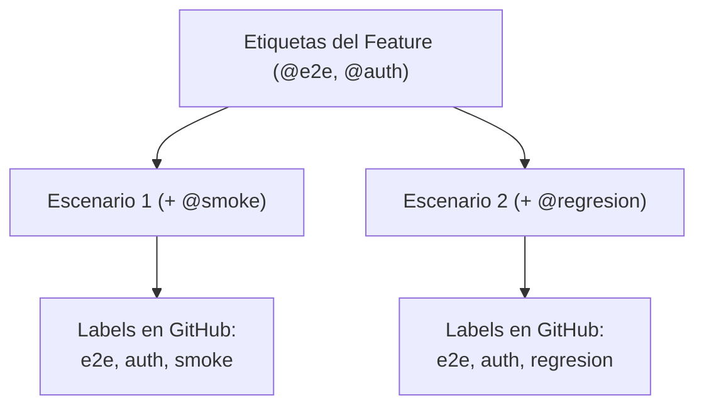

# Estrategia de Etiquetas y Labels

Las etiquetas en Gherkin inician con el símbolo `@`. En Testform, las etiquetas van más allá de agrupar ejecuciones de prueba: definen **tipos de recursos**, **etiquetas remotas (labels)** y **asociaciones de identidad permanente**.

---

## 1. Etiquetas de Alcance (Definición de Recursos)

Testform examina las etiquetas principales a nivel de Feature para determinar el tipo de recurso que debe aprovisionar:

| Etiqueta | Recurso Destino | Equivalente por Sufijo |
| :--- | :--- | :--- |
| `@testcase` | Issue de Caso de Prueba Individual | `*.case.feature` |
| `@testrun` | Ciclo de Ejecución con Checklists | `*.run.feature` |
| `@testplan` | Plan Global / Milestone de Lanzamiento | `*.plan.feature` |

```gherkin
@testcase
Feature: Funcionalidad de Búsqueda
  # Testform gestiona cada Scenario siguiente como un recurso github_testcase
```

---

## 2. Etiquetas de Identidad Única (`@tc-id`)

Una de las capacidades más determinantes de Testform es la **Persistencia de Identidad** (el equivalente al identificador lógico de un recurso en Terraform).

En repositorios convencionales, si un Quality Engineer actualiza el título de un escenario:
- *Sin seguimiento de identidad*: El sistema asume que el caso anterior se borró y crea uno nuevo, duplicando tickets y perdiendo el historial de comentarios y ejecuciones previas.
- *Con Etiquetas de Identidad de Testform*: Testform reconoce la identidad permanente y actualiza el Issue existente in-place sin duplicar nada.

```gherkin
  # La etiqueta @tc-1 fija este escenario a su Issue remoto permanentemente
  @smoke @tc-1
  Scenario: Búsqueda con términos válidos devuelve resultados
    Given el usuario navega a "/search"
    When el usuario busca "portátil"
    Then se muestran los resultados correspondientes
```

El formato estándar es `@tc-[número]` o un nombre nemotécnico como `@tc-login` (definido por el patrón `identity: "tc-*"` en `testform.yml`). Testform utiliza este identificador para componer la clave del recurso en el estado:
`busqueda.case.feature::@tc-1`.

> [!IMPORTANT]
> **Política Obligatoria `identity-required`:** Todo escenario debe incluir obligatoriamente su etiqueta de identidad (por ejemplo `@tc-1`). Testform valida esta política antes de cualquier operación (`plan`, `apply`, `validate`). Esta etiqueta es fundamental porque recursos derivados como `testrun` vinculan las ejecuciones mediante `Rule: archivo.case.feature -> Scenario: @tc-id`.


---

## 3. Categorización y Labels en GitHub

Cualquier etiqueta que no esté reservada para el scope o la identidad se convierte automáticamente en una etiqueta (label) remota:

```gherkin
@checkout @pago @alta-prioridad
Feature: Métodos de Pago

  @visa @tarjeta-credito
  Scenario: Pago con tarjeta Visa válida
```

### Etiquetas Heredadas:
- El Escenario hereda las etiquetas del Feature: `checkout`, `pago`, `alta-prioridad`.
- El Escenario añade sus propias etiquetas: `visa`, `tarjeta-credito`.
- Issue Creado en GitHub:
  - **Labels**: `checkout`, `pago`, `alta-prioridad`, `visa`, `tarjeta-credito`.

---

## 4. Jerarquía de Propagación de Etiquetas

Las etiquetas declaradas en `Feature:` descienden a todos los Escenarios del archivo:


