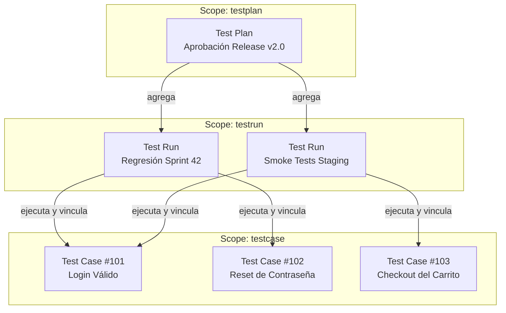

# Jerarquía de Recursos

Testform organiza la infraestructura de pruebas en una pirámide jerárquica de tres niveles. Cada nivel se corresponde con un **Scope** específico en la CLI y se traduce en un recurso gestionado por el Provider activo.



---

## Los Tres Niveles

### 1. `testcase` (La Especificación Atómica)
- **Granularidad**: 1 `Scenario` Gherkin = 1 Issue Remoto.
- **Convención de archivo**: `*.case.feature` o `@testcase` a nivel de Feature.
- **Propósito**: Define criterios de aceptación, precondiciones, pasos (`Given`/`When`/`Then`), etiquetas (labels) y valores de campos personalizados.
- **Identidad en el Estado**: `[archivo.case.feature]::@tc-1` (o según el patrón configurado en `testform.yml`: `tc-*`, `tr-*`, `tp-*`, validado por `identity-required`).

### 2. `testrun` (La Unidad de Ejecución)
- **Granularidad**: 1 archivo Gherkin `Feature` = 1 Issue Remoto (con listas de verificación y comentarios).
- **Convención de archivo**: `*.run.feature` o `@testrun` a nivel de Feature.
- **Propósito**: Representa un ciclo de ejecución. Importa casos de prueba mediante `Rule: archivo.case.feature` y registra estados de ejecución (aprobado, fallido, bloqueado) mediante `* link status = passed`.
- **Identidad en el Estado**: `[archivo.run.feature]`.

### 3. `testplan` (La Campaña Global)
- **Granularidad**: 1 archivo Gherkin `Feature` = 1 Milestone u Overview Issue global.
- **Convención de archivo**: `*.plan.feature` o `@testplan` a nivel de Feature.
- **Propósito**: Gobernanza de alto nivel que agrupa múltiples Testruns de diferentes plataformas, entornos o equipos en un único tablero de control para la aprobación de lanzamientos.
- **Identidad en el Estado**: `[archivo.plan.feature]`.

---

## Control Jerárquico mediante `-scope`

Puedes ejecutar comandos apuntando a toda la infraestructura o acotar el alcance a un nivel específico:

```bash
# Gestionar únicamente casos de prueba
testform plan -scope=testcase
testform apply -scope=testcase

# Gestionar únicamente ciclos de ejecución
testform plan -scope=testrun
testform apply -scope=testrun

# Gestionar planes de lanzamiento
testform plan -scope=testplan
testform apply -scope=testplan
```
