# El Bucle de Reconciliación

En el corazón de Testform opera el **Motor de Reconciliación Declarativa**. En lugar de ejecutar scripts imperativos que crean issues a ciegas o modifican estados sin control, Testform alinea continuamente la infraestructura remota con tus definiciones locales declarativas.

---

## El Motor de Tres Vías (Three-Way Engine)

Testform concilia tres representaciones de la verdad:

```mermaid
flowchart TD
    Local[1. Estado Deseado\nArchivos locales .feature] --> Engine[Motor de Reconciliación]
    State[2. Estado Registrado\ntestform.state] --> Engine
    Remote[3. Estado Real\nAPI del Provider Remoto] --> Engine
    Engine --> DiffCalc{¿Diferencias detectadas?}
    DiffCalc -- Cero Desviación --> UpToDate[Sin Cambios\nInfraestructura al día]
    DiffCalc -- Desviación Detectada --> Plan[Plan de Ejecución\n+ crear, ~ actualizar, - destruir]
    Plan --> Apply[testform apply]
    Apply --> RemoteMutation[Mutación en el Provider]
    RemoteMutation --> AtomicState[Actualización Atómica del Estado]
```



### 1. Estado Deseado (Código Local)
Tus archivos `.feature` bajo control de versiones Git. Representa cómo *debe* ser tu entorno de pruebas.

### 2. Estado Real (Realidad Remota)
Las incidencias, hitos (milestones) e ítems de proyectos que existen actualmente en GitHub, Jira o GitLab. Si un miembro del equipo altera un título o elimina una etiqueta manualmente en la interfaz web, se produce una **desviación fuera de banda (drift)**.

### 3. Estado Registrado (`testform.state`)
La instantánea capturada por Testform tras el último comando `apply` exitoso. Asocia los escenarios locales (identificados por su etiqueta de identidad única) con sus respectivos IDs y URLs remotos.

---

## Hashing Determinista (`localHash`)

Para reducir el consumo de peticiones a las APIs remotas y asegurar la idempotencia, Testform genera una huella criptográfica SHA-256 de cada recurso local:

```text
localHash = SHA-256(Título del Escenario + Pasos + Etiquetas + Variables DSL)
```

### Cómo Evalúa Testform las Desviaciones:
- **Sin cambios**: Si `localHash == state.localHash`, Testform omite el recurso por completo.
- **Actualización local**: Si `localHash != state.localHash`, Testform marca el recurso con `~ update in-place` y calcula el diferencial exacto de propiedades.
- **Nuevo recurso**: Si el escenario no cuenta con identidad en `testform.state`, se planifica con `+ create`.
- **Recurso eliminado**: Si un recurso existe en `testform.state` pero desaparece de los archivos `.feature` locales, se programa con `- destroy`.

---

## Idempotencia en la Práctica

Una operación es **idempotente** si ejecutarla múltiples veces genera exactamente el mismo resultado que ejecutarla una sola vez, sin efectos secundarios indeseados.

Si ejecutas:
```bash
testform apply
```
Y vuelves a ejecutarlo de inmediato sin modificar tus archivos `.feature`:
```bash
$ testform apply

No changes. Your testing infrastructure matches the configuration.

Apply complete! Resources: 0 added, 0 changed, 0 destroyed.
```
No se realiza ninguna llamada de mutación contra GitHub, protegiendo tus límites de tasa de la API (rate limits) y evitando la proliferación de tickets duplicados.
