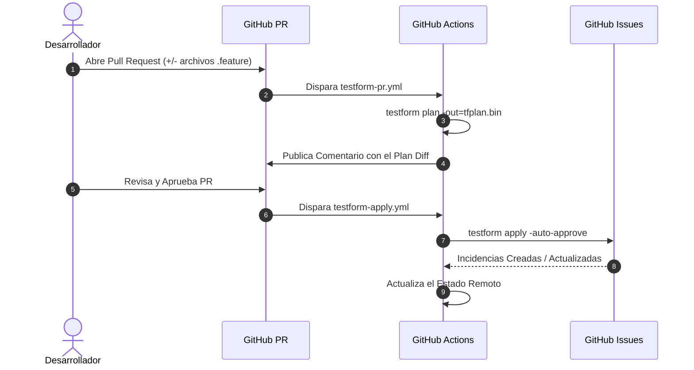

# CI/CD con GitHub Actions

La automatización de Testform en pipelines de CI/CD garantiza que la gestión de pruebas permanezca 100% sincronizada con las ramas de código, pull requests y lanzamientos del equipo.

---

## Flujo Recomendado para Pull Requests

1. **Pull Request Creado / Actualizado**: Se ejecuta `testform plan` y se publica el diferencial de ejecución como comentario automatizado en el PR.
2. **Pull Request Integrado en `main`**: Se ejecuta `testform apply -auto-approve` para sincronizar los cambios definitivos en GitHub Issues.



---

## Workflow de Producción para GitHub Actions

Crea el archivo `.github/workflows/testform.yml`:

```yaml
name: Test-as-Code Sync

on:
  pull_request:
    paths:
      - 'tests/**/*.feature'
      - 'testform.yml'
  push:
    branches:
      - main
    paths:
      - 'tests/**/*.feature'
      - 'testform.yml'

jobs:
  testform:
    runs-on: ubuntu-latest
    permissions:
      contents: read
      issues: write
      pull-requests: write

    steps:
      - name: Checkout del Repositorio
        uses: actions/checkout@v4

      - name: Configurar Node.js
        uses: actions/setup-node@v4
        with:
          node-version: 20

      - name: Instalar Testform
        run: npm install -g @fromeroc9/testform

      - name: Inicializar Testform
        run: testform init -backend-config="bucket=${{ secrets.TF_STATE_BUCKET }}"
        env:
          AWS_ACCESS_KEY_ID: ${{ secrets.AWS_ACCESS_KEY_ID }}
          AWS_SECRET_ACCESS_KEY: ${{ secrets.AWS_SECRET_ACCESS_KEY }}

      # En Pull Request: Planificar y comentar
      - name: Testform Plan
        if: github.event_name == 'pull_request'
        run: testform plan -no-color
        env:
          GITHUB_TOKEN: ${{ secrets.GITHUB_TOKEN }}

      # En Merge a main: Aplicar cambios
      - name: Testform Apply
        if: github.event_name == 'push' && github.ref == 'refs/heads/main'
        run: testform apply -auto-approve
        env:
          GITHUB_TOKEN: ${{ secrets.GITHUB_TOKEN }}
```
