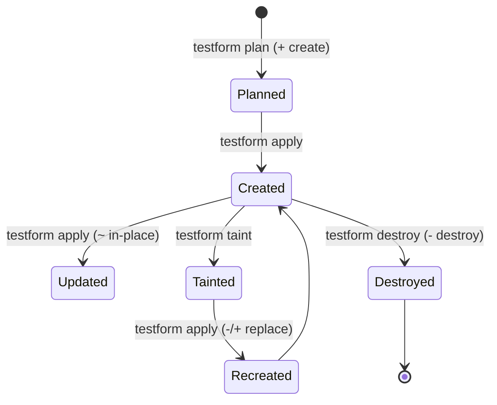

# Ciclo de Vida de los Recursos

Todo recurso gestionado en Testform experimenta un ciclo de vida predecible y determinista guiado por la reconciliación con el archivo de estado.

---

## Los Cuatro Estados del Ciclo de Vida



---

## 1. Creación (`+ create`)
- **Detonante**: Existe un Escenario o Feature local sin registro previo en `testform.state`.
- **Acción**: Testform crea el Issue remoto, captura el número asignado, la URL y el node ID, y los guarda de forma atómica en `testform.state`.

---

## 2. Actualización In-Place (`~ update in-place`)
- **Detonante**: Un escenario ha sido modificado localmente (cambio de pasos, adición de tags, actualización de milestone) y su huella criptográfica SHA-256 (`localHash`) difiere de la registrada en el estado.
- **Acción**: Testform envía una petición `PATCH` / `UPDATE` a la API modificando únicamente los campos alterados, preservando el historial de comentarios y el ID del issue.

---

## 3. Destrucción (`- destroy`)
- **Detonante**: Un escenario fue eliminado localmente o se ejecutó explícitamente `testform destroy`.
- **Acción**: Testform cambia el estado del issue remoto a `closed` (o lo elimina si está configurado) y purga el registro de `testform.state`.

---

## 4. Reemplazo y Marcado como Dañado (`-/+ replace` / `taint`)
- **Detonante**: Un issue remoto fue corrompido manualmente o marcado mediante `testform taint <identidad>`.
- **Acción**: Durante el siguiente `apply`, Testform destruye (cierra) el issue remoto actual, remueve la vinculación previa en el estado y crea un issue totalmente nuevo con una vinculación fresca.

```bash
# Marcar un recurso como dañado
testform taint "login.case.feature::@tc-1"

# Previsualizar el reemplazo planificado
testform plan

# Ejecutar la recreación
testform apply
```
