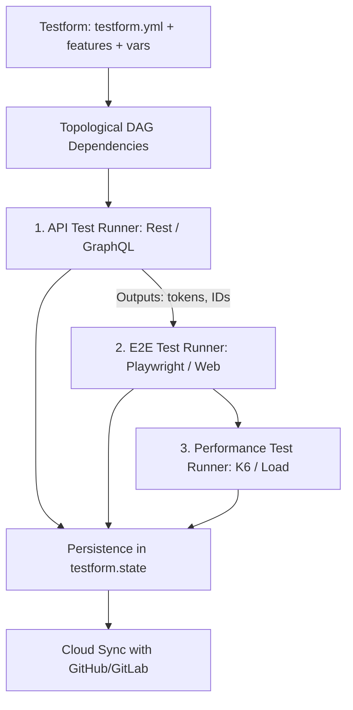

---
title: "Controlling the Test Paradigm: E2E, API, and Performance"
---

# Controlling the Test Paradigm: E2E, API, and Performance

A common initial question when adopting Testform is:  
> *"If test cases are written in Gherkin with `@tc-*`, isn't this just a manual test case manager like Jira or Xray? How does it actually connect with real Playwright scripts, API integration tests, and K6 performance suites?"*

The answer lies in the **Test-as-Code (TaC)** architecture: **Testform is the Control Plane and state persistence layer in Git; Test Runners are the code execution engines**.

---

## 1. Core Principle: Providers vs Test Runners

It is essential not to confuse a **Testform Provider** with an automated **Test Runner**:

| Concept | What is it? | Examples | Role in Testform |
|---|---|---|---|
| **Provider** | Management Platform & State Ledger | `local`, `github`, `gitlab`, `jira` | Manages state storage (`testform.state`), distributed locking (`.lock`), and remote cloud issue synchronization. |
| **Test Runner** | Test Automation Execution Engine | `Playwright`, `Cypress`, `Fetch/Supertest`, `K6`, `Artillery` | Launches browser windows, dispatches HTTP calls, and benchmarks socket network latencies. |

> [!IMPORTANT]
> Testform **does not replace** Playwright or K6. Just as **Terraform does not replace cloud virtual machines** but rather declares and orchestrates them, Testform declares and orchestrates your multi-layered testing suites.

---

## 2. The Three Layers of Test Automation in Testform



### A. E2E Testing (UI / Web / Mobile)
- **In Testform:** Declare the test contract and dependencies:
  ```gherkin
  @e2e @tc-e2e-001 @smoke
  Scenario: TodoMVC task creation
    Given browser opens URL "${var.e2e_app_url}"
    When user enters task "Learn Testform"
    Then todo list contains 1 item
  ```
- **In Runner (Playwright `todo.spec.ts`):**  
  Filter by tag `@tc-e2e-001` and automate browser actions:
  ```typescript
  test('@tc-e2e-001 TodoMVC task creation', async ({ page }) => {
    await page.goto(process.env.TF_VAR_e2e_app_url || 'https://demo.playwright.dev/todomvc/');
    await page.locator('.new-todo').fill('Learn Testform');
    await page.locator('.new-todo').press('Enter');
    await expect(page.locator('.todo-list li')).toHaveCount(1);
  });
  ```

---

### B. API Testing (REST & Microservices)
- **In Testform:** Inject datasets from `data.yml` (`fixtures/todos.json`) and declare expectations:
  ```gherkin
  @api @tc-api-001 @smoke
  Scenario: Create todo via HTTP POST
    Given REST endpoint is "${var.api_base_url}/todos"
    When user sends POST with title "${data.todos_fixture.buy_groceries.title}"
    Then API responds with HTTP status 201
  ```
- **In API Runner (Fetch / Supertest):**  
  Dispatches HTTP call to live endpoint (`https://jsonplaceholder.typicode.com/todos`), validates status 201, and exports created ID as an `${output}` for subsequent UI or integration tests.

---

### C. Performance Testing (Load & SLA Benchmarks)
- **In Testform:** Declare performance latency SLAs (`${var.perf_max_latency_ms}`):
  ```gherkin
  @performance @tc-perf-001
  @depends_on("features/api_todo.case.feature.@tc-api-001")
  Scenario: Concurrent load on Todos endpoint
    Given target endpoint "${var.api_base_url}/todos"
    When 15 concurrent requests are dispatched
    Then p95 latency is below ${var.perf_max_latency_ms} ms
  ```
- **In Performance Runner:**  
  Executes concurrent batches, computes latency percentiles (min, max, avg, p95), and flags **Performance Drift** in state if SLA is violated.

---

## 3. Working Example in Repository

Inspect and run this complete multi-tier workflow directly in the codebase:
📁 **[`examples/todo-app/`](file:///C:/Users/flavi/Desktop/repositorio/testform/examples/todo-app/)**

Run the live pipeline (E2E against live TodoMVC + API against JSONPlaceholder + p95 Load test + `testform.state` generation):

```bash
node examples/todo-app/orchestrator.js
```

