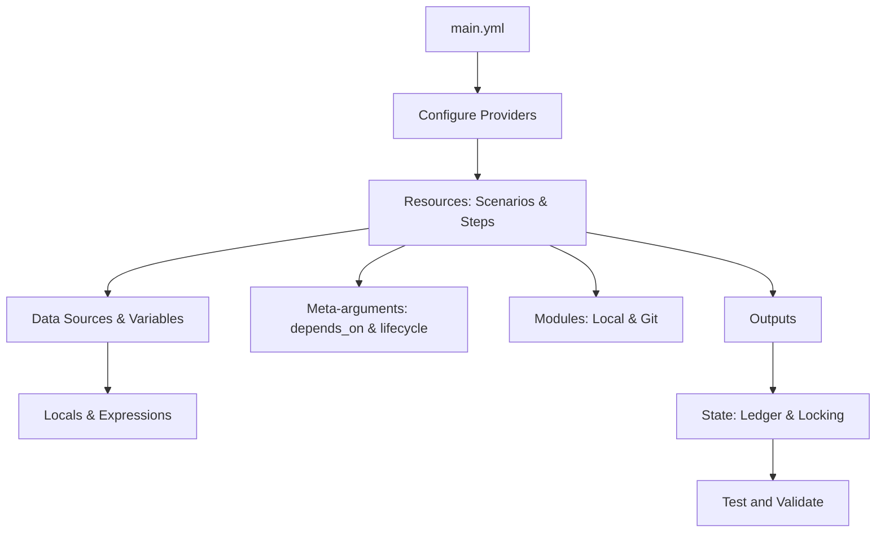

---
title: "Configuration Language in Testform"
---

# Configuration Language in Testform

The **Testform Configuration Language** is the declarative interface for specifying test scenarios, dependencies, data fixtures, and quality orchestration following the **Test-as-Code (TaC)** paradigm.

Just as [Terraform Language](https://developer.hashicorp.com/terraform/language) allows you to model cloud infrastructure through declarative configuration blocks, Testform enables modeling **software verification intent** by blending universal **Gherkin** readability with the declarative power of **YAML**.

---

## Core Principles

1. **Declarative over Imperative:** Describe the desired verification state (`Given`, `When`, `Then`), not fragile glue code or procedural scripts.
2. **Git Versioned:** The entire testing ecosystem (scenarios, variables, fixtures, assertions, and outputs) lives inside your repository as auditable source code.
3. **Deterministic State Management:** A dedicated state file (`testform.state`) records the outcome and attributes of every test resource for incremental planning.
4. **Modular Composition:** Reuse full suites or parameterized step libraries using the `@module` meta-argument with local paths or remote Git repositories.

---

## Language Components

The sidebar navigation mirrors Terraform's core structure, tailored to Testform's active capabilities:

### 1. [Configure Providers](./providers)
Configuring quality management platforms (`github`, `gitlab`, `jira`, `local`) in `main.yml`.

### 2. [Resources](./resources)
Gherkin scenarios and steps serve as declarative resources with canonical addresses (`featurepath.tag`) and managed lifecycles.

### 3. [Data Sources](./data-sources)
Read-only data fixtures (`data.yml`, JSON/YAML files) accessible in step templates via `${data.<source>.<key>}`.

### 4. [Variables](./variables)
Input parameters configured via `vars.yml`, `TF_VAR_*` environment variables, and CLI flags.

### 5. [Locals](./locals)
Named calculated values defined in `local.yml` and `locals:` blocks to simplify repeated expressions.

### 6. [Outputs](./outputs)
Values extracted during tests, persisted in state, and accessible via `testform output` or `${module.<name>.<output>}`.

### 7. [Modules](./modules)
Packaging and sharing test suites via `@module`, supporting Git registries and input parameter passing with `vars={...}`.

### 8. [Meta-arguments](./meta-arguments)
Directives altering scenario orchestration:
- **[depends_on](./meta-arguments/depends-on):** Directed acyclic graph (DAG) ordering dependencies between tests.
- **[lifecycle](./meta-arguments/lifecycle):** Guarding critical tests (`prevent_destroy`) and ignoring dynamic attributes (`ignore_changes`).

### 9. [Search and Import](./search-and-import)
Resource discovery and status filtering with `testform query` and remote issue adoption with `testform import`.

### 10. [State](./state)
State ledger (`testform.state`), distributed locking (`testform.state.lock`), and drift detection.

### 11. [Test and Validate](./validate)
Static analysis with `testform validate` and speculative previews with `testform plan` prior to execution.

