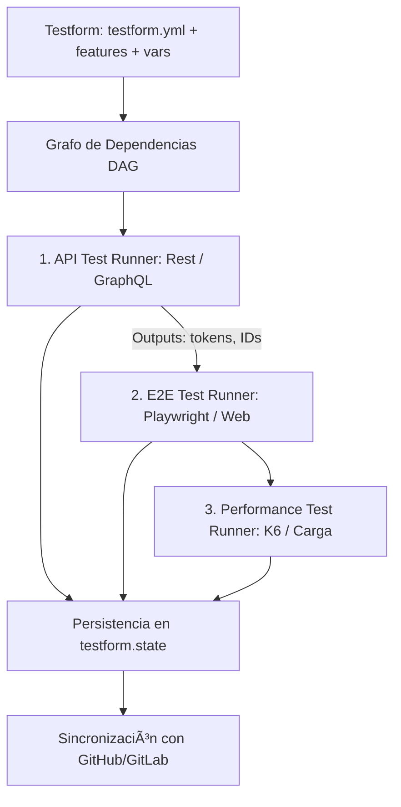

---
title: "Control del Paradigma de Pruebas: E2E, API y Performance"
---

# Control del Paradigma de Pruebas: E2E, API y Performance

Una de las dudas más frecuentes al conocer Testform es:  
> *"Si los casos se escriben en Gherkin con `@tc-*`, ¿esto no es solo un gestor de casos manuales como Jira o Xray? ¿Cómo se relaciona con mis scripts reales de Playwright, mis tests de API y mis pruebas de carga con K6?"*

La respuesta reside en la arquitectura **Test-as-Code (TaC)**: **Testform es el Plano de Control (Control Plane) y la capa de estado en Git; los Test Runners son los ejecutores de código**.

---

## 1. El Concepto Clave: Providers vs Test Runners

Es fundamental no confundir un **Provider de Testform** con un **Test Runner**:

| Concepto | ¿Qué es? | Ejemplos | ¿Qué hace en Testform? |
|---|---|---|---|
| **Provider** | Plataforma de Gestión y Ledger de Estado | `local`, `github`, `gitlab`, `jira` | Gestiona el almacenamiento del estado (`testform.state`), el bloqueo concurrente (`.lock`), y sincroniza issues/tickets en la nube. |
| **Test Runner** | Motor de Ejecución de Código de Automatización | `Playwright`, `Cypress`, `Fetch/Supertest`, `K6`, `Artillery` | Abre navegadores, envía peticiones HTTP y mide latencias de sockets en red. |

> [!IMPORTANT]
> Testform **no reemplaza** a Playwright ni a K6. Así como **Terraform no reemplaza a las máquinas virtuales de AWS** sino que las orquesta y declara, Testform declara y orquesta tus suites de automatización.

---

## 2. Los Tres Mundos de la Automatización en Testform



### A. Pruebas E2E (UI / Web / Mobile)
- **En Testform:** Defines el caso con su ID único y dependencias:
  ```gherkin
  @e2e @tc-e2e-001 @smoke
  Scenario: Creación de tarea en TodoMVC
    Given el navegador abre la URL "${var.e2e_app_url}"
    When el usuario ingresa la tarea "Aprender Testform"
    Then la lista de tareas contiene 1 elemento
  ```
- **En el Runner (Playwright `todo.spec.ts`):**
  El script busca el tag `@tc-e2e-001` y ejecuta las acciones del navegador:
  ```typescript
  test('@tc-e2e-001 Creación de tarea en TodoMVC', async ({ page }) => {
    await page.goto(process.env.TF_VAR_e2e_app_url || 'https://demo.playwright.dev/todomvc/');
    await page.locator('.new-todo').fill('Aprender Testform');
    await page.locator('.new-todo').press('Enter');
    await expect(page.locator('.todo-list li')).toHaveCount(1);
  });
  ```

---

### B. Pruebas de API (Servicios REST y Microservicios)
- **En Testform:** Inyectas datos estructurados desde `data.yml` (`fixtures/todos.json`) y declaras el contrato:
  ```gherkin
  @api @tc-api-001 @smoke
  Scenario: Creación de tarea mediante POST HTTP
    Given el endpoint REST es "${var.api_base_url}/todos"
    When envío un POST con el título "${data.todos_fixture.buy_groceries.title}"
    Then la API responde con código de estado HTTP 201
  ```
- **En el Runner de API (Fetch / Supertest):**  
  Ejecuta la llamada HTTP contra la API real (`https://jsonplaceholder.typicode.com/todos`), verifica el código 201 y extrae el ID generado, el cual queda registrado en `testform.state` y puede pasarse como `${outputs}` a la prueba E2E.

---

### C. Pruebas de Performance y Carga (K6 / Artillery)
- **En Testform:** Declaras los umbrales de SLA esperados (`${var.perf_max_latency_ms}`):
  ```gherkin
  @performance @tc-perf-001
  @depends_on("features/api_todo.case.feature.@tc-api-001")
  Scenario: Carga concurrente contra endpoint de Todos
    Given el endpoint objetivo "${var.api_base_url}/todos"
    When se ejecutan 15 peticiones concurrentes
    Then la latencia máxima p95 es inferior a ${var.perf_max_latency_ms} ms
  ```
- **En el Runner de Performance:**  
  Dispara las peticiones simultáneas, calcula percentiles (min, max, avg, p95), y si la latencia supera el SLA, marca el estado como `failed`, alertando sobre **deriva de rendimiento (*Performance Drift*)**.

---

## 3. Ejemplo Real Disponible en el Repositorio

Puedes inspeccionar y ejecutar este flujo completo directamente en el repositorio:
📁 **[`examples/todo-app/`](file:///C:/Users/flavi/Desktop/repositorio/testform/examples/todo-app/)**

Para ejecutar la demostración completa (E2E contra TodoMVC en vivo + API contra JSONPlaceholder + Carga de latencia p95 + Generación de `testform.state`):

```bash
node examples/todo-app/orchestrator.js
```

